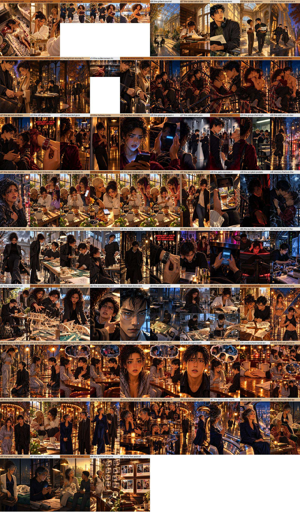
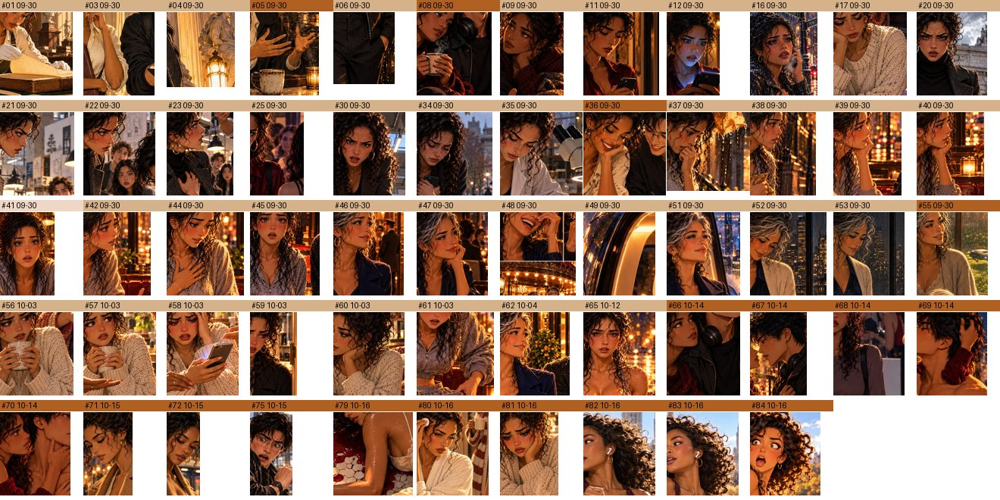

# Before and after: a drifted lead

This page shows the engine on a real problem, with real pictures, and shows the work. The pictures are from the published story *Dating Red Flags* at rel8r.me. The method is the one in [How to resolve character drift after the fact](../2-how-to/HOW-TO-RESOLVE-CHARACTER-DRIFT.md). The decision behind it is [ADR-004](decisions/ADR-004-retrospective-anchor-policy.md).

## What happened

Sam is the lead of the story. The book has 99 pictures and she is in 85 of them. She did not stay the same woman across them. Most of the book shows a woman with light olive skin. The first pictures of the book, and a handful elsewhere, show her with warm golden-brown skin, because the author redid those scenes in October and the rest were drawn in September and never redone. In two pictures her eyes, amber-brown everywhere else, come out light.

The author's decision, in the author's words, was this: it does not matter whether she matches the beginning or the end; the goal is the least amount of regeneration; a lighter or darker skin tone is acceptable as long as she is consistent throughout; and "eye color stays". Her heritage, one quarter Black on her father's side, is a fact of the story and stays in the story's text whatever the pictures do.

That decision has three parts, and the engine has a place for each. A fixed trait goes in `canon_tags`. Everything the author lets follow the pictures goes to `consensus`, the most central picture. A story fact stays in prose. This page is how that played out, with the numbers.

## What you would have, if this were your story

You do not need what this run had. You need:

- A folder of pictures, one per scene, named so you can tell their order.
- Your scene list with the character's token in it (`{{sam-hayes}}`), so the engine knows which scenes show her.
- Her registry entry, with the one or two things about her that may never change under `canon_tags`.
- A browser chatbot that can look at a picture when you paste it, or just your own eyes.
- This repository: `scripts/anchor.mjs`, no API key, no model.

This run also had a face detector and a small local vision model on the author's own computer. They are optional. The sections below say what each one did, and what it did not do.

## Step 1: find her pictures

The scene file holds `{{sam-hayes}}` in the cast of 85 scenes. The engine lists those scenes; nobody reads 99 pictures to find her. This is the sheet, in reading order. The bar above each picture is the hand tag from step 3: tan for light olive skin, brown for warm golden-brown, pale for fair, grey where her face is not readable.



Read the bars left to right. The first row is brown. Then the book goes tan and stays tan, with a few brown pictures where the author had already redone a scene.

## Step 2: put them in the order they were made

The policies care about order: `origin` keeps the first picture, `terminal` the last. Reading order is not generation order.

The original pictures were made in late September and the repository recorded them in one batch on 2026-09-30. The author then redid some scenes in October, and the repository holds the date of each. Nothing else dates the originals: the files were copied, so their file dates are copy dates, and the one true record is the chat history where they were made.

So the generation order used here is: every September original in reading order, then each October picture by its date. The file that holds the rows carries both numbers, the generation order and the place in the story. If you keep one habit from this page, keep this one: name every picture with its number the day you download it.

## Step 3: look at each face and write four words

Each picture was tagged by a person looking at her face. Four keys with a fixed vocabulary, so the words can match:

| Key | Allowed values |
|---|---|
| `skin_tone` | fair, light olive, warm golden-brown, medium brown, dark brown |
| `heritage` | what the picture reads as: white, mixed-race, Black, Asian, other |
| `hair` | texture only: textured curls, wavy, straight, other |
| `eyes` | amber-brown, dark brown, light, not readable |

Hair is texture, not colour, on purpose. At sixty Sam has silver in her curls. That is the story, not drift, so it must not count against her. "Not readable" is for eyes that are closed or turned away: a picture that cannot be read is not evidence either way.

58 pictures show her face well enough to tag. 27 do not: she is seen from behind, or far away, or only her hands are in frame, or the picture is a photograph on a wall. Those are not judged.

This is every readable face, in generation order, cropped from the published pictures. The bar is the skin tone tag.



| Tag | Pictures |
|---|---|
| light olive skin, textured curls | 39 |
| warm golden-brown skin, textured curls | 18 |
| fair skin, textured curls | 1 |
| eyes amber-brown | 41 |
| eyes light (one lit blue by a phone, one grey) | 2 |
| eyes not readable | 15 |

Two tools helped and one did not:

- A face detector found every face in every picture and cut it out, so the person tagging looked at faces, not at whole pages. A chatbot can do the same if you ask it to crop the woman on the left.
- The same detector produced a number per face (a face embedding). `consensus` uses it to find the most central picture. Its limit is in step 5.
- A small vision model on the author's computer was asked the same questions about the same 58 crops. It agreed with the person on 3 of them. It read most faces lit by lamplight as dark brown and Black, and two pale faces at night as Asian with straight hair. Its answers are kept in the evidence files as a caution. The person's tags are the record. If you let a model tag your pictures, look at every answer.

## Step 4: write what may never change, and only that

The engine never reads canon off the pictures. The author writes it, on the registry entry, in the same vocabulary as the tags. For Sam that is one key:

```json
"sam-hayes": {
  "name": "Sam",
  "canon_tags": { "eyes": "amber-brown" },
  "drift_resolution": { "policy": "canon", "pass_threshold": 0.35,
                        "embeddings": "drift/sam-hayes/embeddings.jsonl" }
}
```

Her heritage is not in there. It is a story fact, written in her profile, and no picture tag can change it. Her skin tone and hair are not in there either, because the author decided those may follow the pictures. Put in `canon_tags` only what may never change. Everything else is `consensus`'s job.

## Step 5: run the policies and read the comparison line

One command per policy. Every run prints the same last line, the comparison, so every price is visible next to the chosen one.

```bash
node scripts/anchor.mjs drift/sam-hayes/embeddings.jsonl --policy canon --character sam-hayes
node scripts/anchor.mjs drift/sam-hayes/embeddings.jsonl --policy consensus --character sam-hayes
node scripts/anchor.mjs drift/sam-hayes/tags.jsonl --policy mode
```

The full output is in [anchor-report.txt](assets/before-after/anchor-report.txt). This is what it says, policy by policy:

| Policy | Which picture it keeps as the anchor | To redo, by face similarity | To redo, by tags |
|---|---|---|---|
| `origin` (the first picture made) | the conservation table, September, light olive | 9 | 30 |
| `terminal` (the last picture made) | the reservoir run, October, warm golden-brown | 19 | 46 |
| `consensus` (nearest the average face) | the sacred confession, September, light olive, amber eyes | 6 | not available |
| `mode` (the most common tags) | the all-night booth: 28 of 58 pictures share its four tags | 7 | 30 |
| `canon` (eyes amber-brown, then the most central) | the sacred confession, the same picture as `consensus` | 6 | 17 |

Four things to read off that table.

**With one trait fixed, canon and consensus agree.** The most central of the 41 amber-eyed pictures is also the most central of all 58. The anchor is an untouched September original, which means the author's own first idea of her face is the one the whole book settles on.

**The tag bills count what a person cannot read.** `canon` bills 17 by tags: the 2 light-eyed pictures, plus 15 where her eyes are closed or turned away. Closed eyes are not drift. The engine cannot tell the difference yet, so the person splits the list by hand, below. The same goes for `mode`'s 30 and `origin`'s 30.

**The face similarity column is not about skin tone.** A face embedding is built to recognise the same face across lighting and shading. Against the anchor, 52 of 58 faces score as "the same face" and only 6 fall below the threshold, four of them among the warm golden-brown redos and two small or laughing faces. Similarity catches a different face. Tags catch a different look. For a skin-tone question the tags decide, and the similarity flags are a face check.

**The other choice had a price, and the author saw it before choosing.** The first dry run of this set put skin tone and hair into canon as well. That run billed 40 pictures. Keeping her consistent at the look most of the book already has, with eyes fixed, bills 21. The author chose 21 with both numbers on the table. That is the engine's whole job here: not to pick, but to make sure nobody picks blind.

## Step 6: the list, proposed before anything is redrawn

Against the proposed anchor, the pictures to redo are the 19 whose skin tone differs from it (the October redos, the corner café, the knight in the Nolita night, the lost symphony, the epilogue, and one fair-skinned picture) plus the 2 whose eyes came out light. Twenty-one pictures, each named with its reason:

| Scene | Why | Made |
|---|---|---|
| the soap bubble rupture | skin tone warm golden-brown | October |
| the antiseptic chignon | skin tone warm golden-brown | October |
| the reservoir, the pass | skin tone warm golden-brown | October |
| the reservoir, translucent gaze | skin tone warm golden-brown | October |
| the reservoir, agog | skin tone warm golden-brown | October |
| the brushed-knuckles threshold | skin tone warm golden-brown | October |
| the corner café on Madison | skin tone warm golden-brown | September |
| the sentinel and the watch | skin tone warm golden-brown | October |
| the knight in the Nolita night | skin tone warm golden-brown | September |
| the fire escape, the load rating | skin tone warm golden-brown | October |
| the fire escape, the last inch | skin tone warm golden-brown | October |
| the fire escape, heat on the iron | skin tone warm golden-brown | October |
| the fire escape, the flinch | skin tone warm golden-brown | October |
| forty-five minutes on read | eyes light (phone glow) | September |
| the catastrophic projection, the reaching hand | skin tone warm golden-brown | October |
| the prosecutor's finger | skin tone warm golden-brown | October |
| the somatic recoil | skin tone warm golden-brown | October |
| the lost symphony | skin tone warm golden-brown | September |
| the dream portal | eyes light | October |
| the all-night booth, Sam's aha | skin tone fair | September |
| epilogue, the real work begins | skin tone warm golden-brown | September |

Nothing on this list is redrawn until the author says so, picture by picture. The engine records the anchor (`--write`) only after the author confirms it. At the time of writing the proposal is with the author; this page updates as each pair lands.

## Step 7: redo the pictures, one at a time, with the author's go on each

Nothing here replaces a picture by itself. For each picture on the list, a template builds one edit request: image 1 is the kept picture, image 2 is the anchor, the text says change only her face, skin and hair to match image 2, keep the eyes amber-brown, keep everything else. The author looks at the result beside the old one and says keep or redo. One picture at a time, through the same browser chat the book was made in.

This pair is instructive. The author redid this scene on the day after it was first made, and the redo moved her warmer. Under the anchor the book settles on, the scene is on the list again. Both pictures are real; the lesson is that a redo without a declared anchor is a coin toss, and the declared anchor is what stops the next one.

| 2026-10-15 | 2026-10-16 |
|---|---|
|  |  |

Each new pair the author approves is added here with its scene name, so this page is the running record, not a promise.

## What this costs and what the other choices cost

| | Pictures to redo | What the book says afterwards |
|---|---|---|
| Eyes fixed, the rest by consensus (chosen) | 21 | she is one consistent woman with amber-brown eyes, at the look most of the book already had |
| Skin tone and hair in canon too | 40 | she is the woman of the first pictures everywhere |
| Match the newest pictures (`terminal`) | 46 by tags | the whole book is redrawn to the October look |

The numbers are the point. Whichever you choose, you see every bill before you spend anything, with the pictures behind each one.

## Do this for your own story

1. Write the character's token into every scene from the first day. The engine can then find her pictures.
2. Name every download with its number. Order is evidence you cannot get back.
3. Decide what may never change and write only that under `canon_tags`, before the first picture if you can. Story facts go in prose, not in tags.
4. When something looks off, make the face sheet and tag it by hand, with a fixed vocabulary that has a word for "cannot tell". A chatbot may suggest; you decide.
5. Run every policy and read the comparison line. Every price is there to be chosen with your eyes open.
6. Record the anchor. Redo within the list, one picture at a time, and keep the pairs.

## The files behind this page

- [`anchor-report.txt`](assets/before-after/anchor-report.txt): the engine's own output for the runs above.
- The row files (`embeddings.jsonl`, `tags.jsonl`), the face picks and the proposed list live in the story's private repository, because they hold the story's working files. Their shape is the one in [examples/anchor](../../examples/anchor/README.md): image, order, tags, hash, and for the embedding file one vector per face.
- The engine: [`scripts/anchor.mjs`](../../scripts/anchor.mjs). Field reference: [Registry fields](../3-reference/REGISTRY-FIELDS.md).
