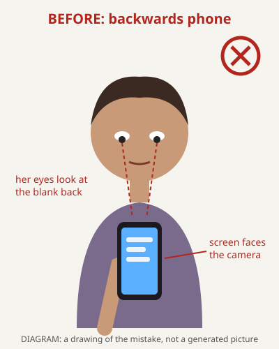
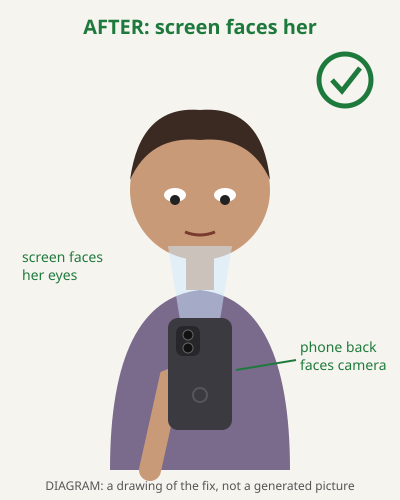
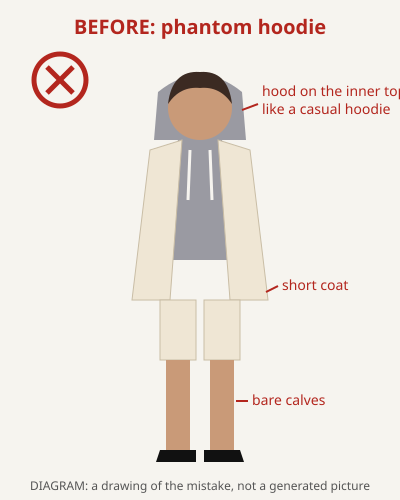
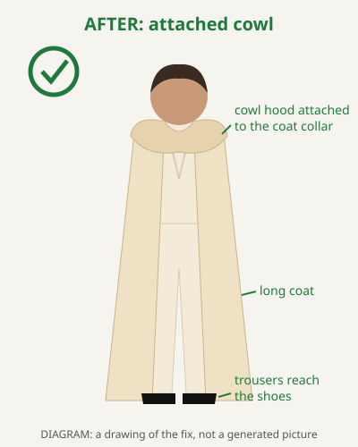

<!-- generated by scripts/showcase.mjs; do not edit. Change showcase/cases/<slug>/case.json, then run: npm run showcase -->

# Before & After: mistakes AI picture tools make, and how this repository stops them

**Why this page exists:** AI picture tools make the same few mistakes again and again. A coat loses its hood. A phone screen faces the camera while the person stares at the back of it. A face changes between two pictures of the same scene. Each case below shows the mistake next to the fix, says in plain words what broke, and says which part of this repository stopped it.

**How to add your own case (about 30 seconds):**

1. Run `node scripts/showcase.mjs --new <short-name>`. It makes a folder in `showcase/cases/` with a `case.json` to fill in.
2. Put `before.png` (the mistake) and `after.png` (the fix) in that folder. A `.jpg`, `.webp` or `.svg` works too.
3. Replace the template's sentences in `case.json` with your own.
4. Run `npm run test:showcase` to check it, then `npm run showcase` to rebuild this page and `showcase.html`.

Every case says what kind of pictures it shows: **real pictures** from an AI tool, a **diagram** that draws the kind of mistake, or a **placeholder**. A diagram is never passed off as a real picture.

## Cases

- [The Prosecutor's Finger: a redo with no anchor is a coin toss](#the-prosecutors-finger) (One look chosen and kept)
- [Backwards Phone: screen to the camera, eyes on the back](#backwards-phone) (Objects held the right way)
- [Phantom Hoodie vs. Attached Cowl](#phantom-hoodie) (Clothes in layers)

<a id="the-prosecutors-finger"></a>

## The Prosecutor's Finger: a redo with no anchor is a coin toss

**Kind of fix:** One look chosen and kept (`anchor`). **What the pictures are:** Real pictures: both images came out of an AI picture tool.

| First version, 2026-10-15 | Redone the next day, before an anchor existed |
|---|---|
|  |  |

**What broke:** The author redid this scene the day after it was first made. Nothing told the AI which version of the lead was the right one, so the redo moved her skin to a warmer brown and changed the room, her clothes and the light as well. Each redo was a coin toss, and across the book the same woman ended up with two skin tones.

**How it was fixed:** The anchor policy (scripts/anchor.mjs, ADR-004) asks the author two questions: what must never change (for her, eye colour) and, for everything else, which look to keep (fewest redraws). It picks one anchor picture and records it on her registry entry. Every later redo sends a close-up from that anchor and says: change only her face, skin and hair to match it, keep the eyes amber-brown, keep everything else. Both pictures here were made before the anchor existed, so they show the problem, not the fix at work. Checked at face size against the anchor later, the redone version happens to match it, so it stays.

No prompts were saved for this pair.

**Where the fix lives in this repository:** [`scripts/anchor.mjs`](../scripts/anchor.mjs), [`docs/4-explanation/decisions/ADR-004-retrospective-anchor-policy.md`](../docs/4-explanation/decisions/ADR-004-retrospective-anchor-policy.md), [`docs/4-explanation/BEFORE-AND-AFTER-A-DRIFTED-LEAD.md`](../docs/4-explanation/BEFORE-AND-AFTER-A-DRIFTED-LEAD.md)

<a id="backwards-phone"></a>

## Backwards Phone: screen to the camera, eyes on the back

**Kind of fix:** Objects held the right way (`affordance`). **What the pictures are:** Diagram: a simple drawing that shows the kind of mistake. It is not a generated picture.

| Before: the mistake | After: the fix |
|---|---|
|  |  |

**What broke:** Asked for a person looking down at a phone from the front, AI picture tools turn the glowing screen toward the camera, because most phone photos they learned from show the screen. The person ends up staring at the blank back of the phone. This is called canonical view bias, and the result is gaze-affordance decoupling: the eyes point one way and the screen points the other.

**How it was fixed:** scripts/check-affordance.mjs --check-prompt stops a phone prompt that is missing "back chassis facing camera, screen angled inward toward face" and prints the phrase to add. The before prompt below fails that check and the after prompt passes it. After the pictures are made, --batch checks a whole folder and fails any picture with a backwards phone, or with no saved answer.

<details><summary>The prompts, before and after</summary>

Before:

```text
Front medium shot of CHARACTER 1 looking down at her phone in the kitchen.
```

After:

```text
Front medium shot of CHARACTER 1 looking down at her phone in the kitchen, back chassis facing camera, screen angled inward toward face.
```

Words the fix added: `kitchen, back chassis facing camera, screen angled inward toward face.`

</details>

**Where the fix lives in this repository:** [`scripts/check-affordance.mjs`](../scripts/check-affordance.mjs), [`test/affordance.test.mjs`](../test/affordance.test.mjs), [`docs/2-how-to/HOW-TO-ENFORCE-STORY-INVARIANTS-AND-AFFORDANCES.md`](../docs/2-how-to/HOW-TO-ENFORCE-STORY-INVARIANTS-AND-AFFORDANCES.md)

<a id="phantom-hoodie"></a>

## Phantom Hoodie vs. Attached Cowl

**Kind of fix:** Clothes in layers (`garment-layering`). **What the pictures are:** Diagram: a simple drawing that shows the kind of mistake. It is not a generated picture.

| Before: the mistake | After: the fix |
|---|---|
|  |  |

**What broke:** Asked for "a cream silk hooded pantsuit" in one phrase, an AI picture tool does not know which piece the hood belongs to or how long the coat should be. It puts the hood on the inner top like a casual hoodie, or drops it, and draws a short coat with bare calves between the hem and the shoes.

**How it was fixed:** The wardrobe file writes the outfit as layers: the outer coat, the cowl hood attached to the coat's collar, the top, the trousers, the shoes and the fabric. scripts/compile-shot.mjs writes them in the order you would see them, coat with its hood over the top, and puts the outfit's own avoid words (bare leg, exposed calf, short coat, detached hood, casual hoodie) into AVOID on every shot. A test in test/continuity.test.mjs proves both.

<details><summary>The prompts, before and after</summary>

Before:

```text
CHARACTER 1 wearing a cream silk hooded pantsuit, standing on a porch at night.
```

After:

```text
CHARACTER 1 WEARING: Floor-grazing cream silk-satin long overcoat with dramatic drape, slightly shorter than pant hem with Deep Renaissance cowl hood attached to overcoat collar, draped softly down the back shoulders over Plunging crossover wrap bodice in matching cream silk crepe, Fluid wide-leg palazzo trousers resembling a long skirt until movement separates legs, Black pointed-toe kitten heels with narrow gap between hem and shoe, continuous trouser drape with zero bare leg, fabric: Heavyweight matte silk crepe with muted ivory satin inner lining. Standing on a porch at night. AVOID: bare leg, exposed calf, short coat, detached hood, casual hoodie.
```

Words the fix added: `WEARING: Floor-grazing` · `silk-satin long overcoat with dramatic drape, slightly shorter than pant hem with Deep Renaissance cowl hood attached to overcoat collar, draped softly down the back shoulders over Plunging crossover wrap bodice in matching cream` · `crepe, Fluid wide-leg palazzo trousers resembling a long skirt until movement separates legs, Black pointed-toe kitten heels with narrow gap between hem and shoe, continuous trouser drape with zero bare leg, fabric: Heavyweight matte silk crepe with muted ivory satin inner lining. Standing` · `AVOID: bare leg, exposed calf, short coat, detached hood, casual hoodie.`

</details>

**Where the fix lives in this repository:** [`examples/continuity/wardrobe-and-props.json`](../examples/continuity/wardrobe-and-props.json), [`scripts/compile-shot.mjs`](../scripts/compile-shot.mjs), [`test/continuity.test.mjs`](../test/continuity.test.mjs), [`docs/2-how-to/HOW-TO-ENFORCE-STORY-INVARIANTS-AND-AFFORDANCES.md`](../docs/2-how-to/HOW-TO-ENFORCE-STORY-INVARIANTS-AND-AFFORDANCES.md)

---

This page is built from `showcase/cases/*/case.json` by `scripts/showcase.mjs`. To change it, change a case and run `npm run showcase`. The same cases, with a slider to compare each pair, are in `showcase.html` (download the repository and open it in a browser).
