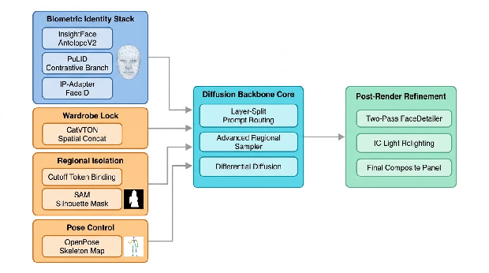
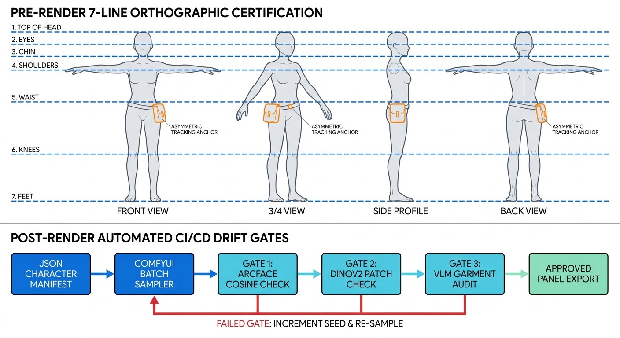

# **Solving Character and Asset Consistency in Generative AI Production Pipelines**

## **1\. Visual Identity Locking: Architectures, Adapters, and Conditioning**

Achieving deterministic character continuity across sequential visual narratives—such as visual novels, graphic novel panels, cinematic storyboards, and game asset pipelines—requires overcoming a fundamental architectural property of latent diffusion and flow-matching models: they are probabilistic distribution samplers designed for creative variance rather than persistent object tracking1. When conditioned solely on natural language text, diffusion models sample a different point on the learned data manifold for every noise initialization, yielding an average facial and structural consistency rate of only 30% to 50%3. Production-grade identity locking therefore depends on constraining the denoising trajectory through weight-space fine-tuning, decoupled cross-attention adapters, or multimodal sequence concatenation5.

### **Fine-Tuning Paradigms: Textual Inversion vs. DreamBooth vs. LoRA**

At the foundation of weight-based customization, Textual Inversion, DreamBooth, and Low-Rank Adaptation (LoRA) share an identical forward diffusion training loop5. A reference image  is compressed by a Variational Autoencoder (VAE) encoder  into a latent representation , perturbed with isotropic Gaussian noise  at timestep  to form , and passed into a denoising network  alongside text conditioning  to minimize the reconstruction objective5:  
  
The divergence among these three techniques occurs entirely during backpropagation, defined by which parameters are exposed to gradient updates and how those updates are parameterized5.

| Customization Architecture | Trainable Parameter Destination | Typical Artifact Footprint | DreamBench DINO Score (Subject) | DreamBench CLIP-I Score (Subject) | DreamBench / SD CLIP-T Score (Prompt) | Primary Production Failure Modes |
| :---- | :---- | :---- | :---- | :---- | :---- | :---- |
| **Textual Inversion (TI)** | Single new token vector  in Text Encoder embedding table; U-Net/DiT and VAE frozen5 | \~0.013 MB (13 KB)9 | 0.56910 | 0.78010 | 0.255 – 0.30210 | Low representational capacity; fails if the frozen base model lacks prior knowledge of specific facial geometry5 |
| **DreamBooth (Full Fine-Tuning)** | Entire U-Net weight manifold (requires\_grad=True); VAE and Text Encoder frozen5 | 2.0 GB – 6.5+ GB (Full Checkpoint)5 | 0.69610 | 0.81210 | 0.30610 | Language drift and background memorization without Prior Preservation Loss; cannot combine multiple characters without destructive checkpoint merging9 |
| **LoRA / DreamBooth-LoRA** | Low-rank matrices  injected into cross-attention projection layers (to\_q, to\_k, to\_v, to\_out.0)5 | 1.6 MB () to 50–150 MB ()3 | 0.499 – 0.690+ (scales with rank/regularization)19 | 0.752 – 0.800+20 | 0.326 – 0.34111 | Trigger word collision across multiple active LoRAs; overfitting to training attire and pose if dataset lacks angular diversity1 |
| **Regularized / Hybrid Fine-Tuning (DEFT / HiFi Tuner / FF-LoRA)** | Rank-relaxed or Gram-matrix geometry-regularized adapter matrices \+ token embeddings11 | 0.1 MB (LiDB) to 100 MB18 | \+0.012 to \+0.096 over baselines19 | 0.833 (DreamBench SOTA)19 | 0.314 – 0.36111 | Higher computational overhead during dual-pass training (computing Gram matrices over  spatial tokens)15 |

Textual Inversion freezes the entire generative backbone and expands the tokenizer dictionary by a single row for a custom token string, optimizing only that embedding vector initialized from an existing class word5. Because the visual synthesis weights remain unaltered, Textual Inversion cannot teach the network novel structural morphologies; it merely acts as an optimized coordinate pointer that activates pre-existing latent priors5. Consequently, while highly portable, it exhibits a hard fidelity ceiling (DINO similarity of  vs.  for DreamBooth) that renders it inadequate for locking specific human or stylized protagonist faces10.  
DreamBooth resolves this capacity bottleneck by binding the target subject to a rare existing vocabulary token (such as sks) juxtaposed with a coarse class noun (e.g., "a photo of sks dog") while unfreezing the entire denoising U-Net5. However, fine-tuning all backbone parameters on 3 to 5 images rapidly induces two catastrophic failure modes: *language drift*, wherein the model loses broader syntactic and semantic associations of the target class noun, and *context memorization*, wherein the background and lighting of the training photos become permanently entangled with the character's identity9. DreamBooth counteracts this via an autogenous Class-Specific Prior Preservation Loss (PPL), supervising the network concurrently on its own frozen class generations  using weight factor 5:  
  
In modern production pipelines, full-checkpoint DreamBooth has been largely superseded by **DreamBooth-LoRA**, which retains the instance-plus-prior training recipe of DreamBooth while routing gradient updates exclusively into low-rank decomposition matrices attached to the cross-attention layers5. Rather than modifying a frozen weight matrix , LoRA parameterizes the update  via two low-rank matrices  and  where rank , scaled by hyperparameter 5:  
  
On Diffusion Transformer (DiT) architectures such as **FLUX.1-dev** and **FLUX.2 Max**, LoRA training reaches a 90% to 95% character and pose consistency ceiling using 15 to 30 curated reference images at  resolution3. Optimal convergence is achieved at a learning rate of , batch size 1 to 2, network rank , and approximately 40 steps per image (1,000 to 1,400 total steps), executing in 15 to 30 minutes on consumer GPUs1. Furthermore, selective layer optimization—targeting specific transformer blocks (such as layers 7, 12, 16, and 20 in Flux)—reduces adapter overhead without sacrificing identity retention16. To prevent multi-LoRA interference when composing multiple characters or styles, recent regularizers such as **FF-LoRA** constrain local metric distortion during training by matching the Gram matrix of  subsampled spatial tokens between the frozen base model and the LoRA-adapted forward pass, preserving the underlying latent geometry15.

### **Zero-Shot and Few-Shot Reference Conditioning**

While LoRA provides high identity fidelity for flagship protagonists, training a dedicated 150 MB adapter requiring 30 minutes of compute for every minor or single-scene character creates a severe production bottleneck17. Zero-shot and few-shot reference adapters bypass gradient descent at test time by extracting biometric or semantic features from one or more reference images  and injecting them directly into the denoising pass6.  
The foundational mechanism of zero-shot conditioning is **IP-Adapter** (Image Prompt Adapter), which freezes the base text-to-image model and attaches parallel cross-attention layers dedicated to image features6. Given query matrices  projected from the U-Net or DiT spatial features, standard text keys  and values , and projected identity keys  and values  scaled by weight , the combined cross-attention output is computed as6:  
  
Within the IP-Adapter family, architectural capability varies sharply by encoder design27. **IP-Adapter-Plus and Plus-Face** replace coarse global CLIP image embeddings with patch-level features extracted prior to the CLIP ViT-H projection layer, compressed into 16 tokens via a Perceiver-Resampler (Q-Former) or mapped directly via a Multi-Layer Perceptron in **IP-Adapter-Full-Face**27. While effective at transferring overall portrait lighting, palette, and general facial structure, CLIP vision encoders are trained for semantic image-text alignment rather than biometric discrimination, causing fine-grained facial geometry to drift27. **IP-Adapter-FaceID** addresses this by substituting the CLIP vision encoder with a pre-trained **InsightFace** (buffalo\_l or antelopev2) face recognition backbone that extracts a discriminative 512-dimensional **ArcFace** identity embedding, paired with a companion LoRA to stabilize identity projection27.  
Because pure ArcFace embeddings omit spatial structure and hairstyle, **IP-Adapter-FaceID-Plus** fuses the InsightFace ID embedding (acting as the query) with CLIP ViT-H patch embeddings inside a Q-Former27. However, because the diffusion model learns CLIP features more easily than biometric vectors, standard FaceID-Plus over-constrains facial structure and degrades text editability29. **FaceID-PlusV2** corrects this by restructuring the projection into a direct shortcut path and applying a 50% drop-path regularization strategy to the CLIP embedding during training, exposing an independent inference dial to scale CLIP structural influence separately from biometric identity27. Finally, **IP-Adapter-FaceID-Portrait** eliminates both the companion LoRA and ControlNet dependencies while accepting multiple cropped facial references (typically 5 images weighted at  each)27. Averaging normalized ArcFace embeddings across diverse angles and expressions filters out instance-specific lighting and expression noise, functioning as an instant training-free character model35.  
To surpass the structural limitations of pure cross-attention adapters, **InstantID** couples a pre-trained ArcFace encoder (antelopev2) with an **IdentityNet**—a specialized ControlNet architecture conditioned on five facial keypoints (two eyes, nose tip, and two mouth corners) wherein text prompts are replaced directly by the ID embedding—while keeping the base U-Net completely frozen25. This spatial-plus-biometric architecture makes InstantID exceptionally resilient at rendering extreme head turns and steep camera angles39. However, InstantID exhibits three notable production artifacts: it locks the generated face rigidly to the spatial keypoint layout, suffers from severe color saturation and contrast "burn-in" at standard Classifier-Free Guidance (CFG) scales (forcing operators to cap CFG or restrict it to inpainting passes), and experiences identity drift when high guidance scales pull the generation toward the text prompt distribution25.  
**PhotoMaker (V1 and V2)** adopts an alternative paradigm: rather than injecting spatial ControlNets, it encodes  reference photos of a character into a **Stacked ID Embedding** and fuses this composite tensor directly with the class noun embedding inside the text encoder space, supported by LoRA residuals in the attention blocks6. PhotoMaker V2 upgrades the facial extraction backbone and adds native compatibility with ControlNet and T2I-Adapter43. In comparative evaluations, PhotoMaker achieves substantially higher prompt alignment (CLIP-T) and natural expression malleability (such as transforming a smiling reference into an angry scowl) than InstantID, which tends to copy-and-paste the reference mouth geometry41. The trade-off is a lower ceiling on raw biometric facial similarity compared to dedicated ArcFace-locked foundations31.  
**PuLID (Pure and Lightning ID)** resolves the tension between biometric similarity and prompt editability via **Contrastive Alignment** and an accurate **Lightning T2I ID Loss**6. PuLID extracts multi-granular features using both InsightFace antelopev2 (ArcFace) and **EVA-CLIP**, projecting them through an IDFormer into 32 identity tokens 26. During training, PuLID runs two parallel paths sharing the same prompt and initial noise: a pure text-to-image path and an ID-conditioned path45. By enforcing semantic and layout alignment losses (, ) between the U-Net features of both branches, PuLID teaches the adapter to insert the face *without* altering the background, lighting, composition, or artistic style of the base model6. Simultaneously, leveraging a 4-step SDXL-Lightning branch to synthesize a clean, photorealistic  face from pure noise  allows PuLID to compute an exact biometric cosine loss () using an independent face recognition network6:  
  
On the DivID-120 benchmark, PuLID achieves a CurricularFace similarity (FaceSim) of , a CLIP-T score of , and a CLIP-I preservation score of , outperforming InstantID and IP-Adapter in preserving base model aesthetics and lighting6. When ported to DiT backbones (**PuLID-Flux** and **PuLID-Flux2**), as well as competing residual DiT injectors like **InfiniteYou** (which utilizes InfuseNet to inject ArcFace embeddings as residual signals across transformer blocks) and **HyperLoRA**, these tuning-free methods achieve 85% to 90%+ identity consistency17. Furthermore, state-of-the-art pipelines such as **NanoPocket** stack **InstantID \+ PuLID \+ IP-Adapter FaceID** concurrently on a **FLUX.1** base—using InstantID for high-level cranial geometry, IP-Adapter FaceID for fine-grained skin tone and micro-expressions, and PuLID for contrastive anti-drift pressure during high-CFG sampling25.

| Identity Adapter / Foundation | Feature Extraction Backbones | Conditioning Mechanism | Optimal Inference Weights | Primary Strengths | Documented Artifacts & Licensing Constraints |
| :---- | :---- | :---- | :---- | :---- | :---- |
| **IP-Adapter-FaceID-PlusV2** | InsightFace (buffalo\_l) \+ CLIP ViT-H (50% drop-path shortcut)27 | Decoupled Cross-Attention \+ Q-Former \+ Companion LoRA27 | IPA Weight: ; LoRA Scale:  \[cite: 6, 27\] | Controllable structural vs. biometric weight; captures skin tone and micro-accessories25 | Companion LoRA bleeds reference color palette if weighted too high; non-commercial InsightFace license27 |
| **InstantID** | InsightFace (antelopev2) \+ 5-Point Facial Landmarks30 | Decoupled Cross-Attention \+ IdentityNet (Spatial ControlNet)31 | Weight: ; end\_at: ; CFG:  \[cite: 6, 38, 40\] | Unmatched accuracy on extreme head turns and profile angles39 | Color burn-in at high CFG; rigid expression/pose lock; SDXL-native (no official Flux repo); non-commercial license38 |
| **PhotoMaker V2** | Custom Tuned ID Encoder \+ Stacked Multi-Image Embeddings42 | Text-Token Embedding Fusion \+ Attention LoRA Modules42 | Trigger token fused at class noun; LoRA scale:  \[cite: 42, 43\] | High prompt editability (CLIP-T); natural expression changes; strong East Asian phenotype fidelity41 | Lower raw biometric similarity than Arc2Face/InstantID on single-image inputs31 |
| **PuLID (SDXL / Flux.1 / Flux.2)** | InsightFace (antelopev2) \+ EVA-CLIP via IDFormer (32 tokens)26 | Contrastively Aligned Cross-Attention ()26 | CFG: ; Fidelity Mode enabled26 | Minimal intrusion on scene lighting, style, and background (CLIP-I ); race-agnostic fidelity6 | Can copy reference hairstyle/expression rigidly; minor facial softness from Lightning ID loss; non-commercial InsightFace weights6 |
| **Arc2Face** | InsightFace ArcFace vector projected via fine-tuned CLIP Text Encoder31 | Pure ID Foundation Model (disregards language prompts) \+ 3DMM/FLAME Adapter31 | CFG: ; Steps:  \[cite: 49\] | Highest biometric retention ( Synth-500 similarity) and CFP-FP pose invariance31 | Cannot perform text-driven stylization natively without downstream adapters31 |
| **FLUX.1 Kontext (Dev / Pro / Max)** | 12B Multimodal Flow-Matching DiT (ae.safetensors \+ DualCLIP/T5)7 | Sequence Concatenation of Context Image Tokens \+ Instruction Tokens7 | Denoise: ; Flux Guidance: ; Steps:  \[cite: 52, 53\] | Training-free full-character and attire preservation across iterative edits ( aCCS)7 | Degrades over  chained sequential edits; requires  VRAM (or GGUF Q4/Q5 quantization)7 |

A critical operational hazard across open-weight pipelines is the **InsightFace Licensing Trap**: the underlying inswapper\_128, buffalo\_l, and antelopev2 weights powering InstantID, PuLID, IP-Adapter FaceID, and ReActor are distributed under strict non-commercial research terms25. Commercial studios deploying these adapters in revenue-generating games or publications must either secure a commercial enterprise license from InsightFace, replace the face analysis backbone with Apache-2.0 licensed **AuraFace** embeddings, or utilize pure Apache-2.0 **FLUX LoRAs** and **FLUX.1 Kontext**3.

### **Closed-System Reference Conditioning: Midjourney and ChatGPT Image Studio**

In proprietary cloud pipelines where model weights are inaccessible, identity locking relies on image-guided conditioning tokens and autoregressive context management. Midjourney V6 introduced Character Reference (--cref \[URL\]) paired with Character Weight (--cw 0 to 100, defaulting to 100\)56. The \--cw parameter governs a spatial feature inclusion hierarchy: \--cw 0 isolates facial biometrics while permitting text prompts to freely alter hairstyle and wardrobe; \--cw 25 locks face and hair; \--cw 50 locks face, hair, and upper/partial attire; and \--cw 100 enforces a total lock over face, hair, and complete costume56. In commercial mascot and comic production, setting \--cw 85–95 balances strict visual continuity with pose flexibility58. In **Midjourney V7**, \--cref is superseded by **Omni Reference (--oref \[URL\])** and **Omni Weight (--ow 1 to 1000, default 100\)**, which generalizes conditioning from human faces to arbitrary subjects, creatures, props, and vehicles57. However, V7 restricts prompts to a *single* \--oref image URL per generation and incurs elevated GPU billing57. Across both V6 and V7, the primary failure mode is *prompt-reference contradiction*: if a user supplies a brown-eyed reference image but writes "blue eyes" or re-litigates facial features in the text prompt, the conditioning vectors collide, forcing Midjourney to synthesize a hybridized stranger57.  
In OpenAI's ecosystem, early DALL-E 3 workflows relied on referencing a 16-character gen\_id or fixed seed number alongside a rigid four-part prompt template (Core Appearance \+ Simple Worn Items \+ 3–4 Style Attributes \+ Dynamic Scenario)59. Following OpenAI's migration from DALL-E 3 to the native autoregressive multimodal architecture of **GPT-4o** and **GPT Image 2.5**, legacy gen\_id schemas ceased functioning deterministically62. Because autoregressive image generation predicts visual patches sequentially conditioned on the entire conversational token stream, multi-turn prompting without uploaded visual anchors results in rapid identity drift and positional swapping in two-character scenes62.

### **Mathematical and Practical Limits of Identity Drift**

Even with state-of-the-art adapters, character identity is bounded by three mathematical and physical limits when subjected to extreme cinematic direction: out-of-plane angular rotation, scale compression inside the VAE latent space, and expression-identity gradient opposition.  
First, biometric encoders like ArcFace normalize feature vectors  and class centers  onto a 512-dimensional hypersphere, optimizing geodesic distance via an additive angular margin penalty 66:  
  
While this enforces tight intra-class compactness for frontal and three-quarter portraits (yaw ), 2D affine face alignment breaks down under severe out-of-plane rotation68. Empirical head-pose evaluations demonstrate that when a reference gallery image or target generation exceeds a pitch of  and a yaw of  to  (and especially at  full profile), self-occlusion obscures half of the ocular and nasal landmarks70. Consequently, the cosine similarity  drops precipitously below the standard  verification threshold into the false-rejection zone (), causing single-reference adapters like PuLID and HyperLoRA to either snap the head back toward the camera at an unnatural neck angle or hallucinate an off-model profile39. Overcoming the  yaw barrier requires either multi-view embedding averaging (IP-Adapter-FaceID-Portrait), pose-adaptive margin networks (PoseFace), or 3D Morphable Model (3DMM) conditioning (Arc2Face)33.  
Second, a pervasive misconception in generative production is that small faces in wide action shots degrade during diffusion sampling; in reality, they are destroyed inside the **Variational Autoencoder (VAE)** prior to the first denoising step72. Standard latent diffusion VAEs apply a spatial downsampling stride of , mapping an  RGB image into an  latent tensor73. For SD1.5 and SDXL ( latent channels), the spatial-channel compression ratio is73:  
  
For **FLUX.1**, **FLUX.2**, and **SD3** ( latent channels), the compression ratio is reduced by a factor of four73:  
  
Despite FLUX's  higher latent channel capacity, the  spatial grid bottleneck remains absolute: any anatomical feature smaller than  pixels in pixel space is collapsed into a single latent pixel73. In a wide establishing or action shot () where a full-body character's face spans only  pixels, the entire facial identity—irises, eyelids, nose bridge, and mouth—is compressed into a  latent patch72. At this resolution, biometric cross-attention tokens () cannot resolve spatial landmarks, resulting in melted or generic faces upon VAE decoding unless rescued by a secondary cropped pixel-space inpainting pass (FaceDetailer / ADetailer)26.  
Third, in tuning-free adapters (PuLID, InstantID), the reference image's facial expression (e.g., a closed-mouth smile) is entangled within the extracted EVA-CLIP and ArcFace vectors36. When the text prompt demands a radical emotional shift (e.g., screaming in terror or weeping), the cross-attention update  opposes the text-conditioned gradient4. If  is high, identity overrides emotion and flattens the expression back to neutral; if  is lowered, emotion overrides identity and warps the character's bone structure4. Furthermore, unmasked cross-attention injection causes *identity leakage* into non-facial regions of the canvas26. Recent scheduling frameworks such as **SpatialID** mitigate this by partitioning the 25-step Flux denoising loop into three distinct regimes: *Phase 1 (Noise-Dominated, )* using a Gaussian center prior, *Phase 2 (Structure Formation, )* extracting dynamic L2-norm cross-attention masks, and *Phase 3 (Texture Fusion, )*, smoothly balancing FaceSim () and CLIP-T () while eliminating background contamination26.

## **2\. Wardrobe, Prop, and Anatomical Lock Mechanics**

While facial adapters stabilize craniofacial geometry, narrative suspension of disbelief collapses rapidly when secondary attributes—such as coat buttons, collar silhouettes, fabric weaves, scars, glasses, or relative character heights—mutate between wide shots and close-ups4. Because face-centric adapters (InstantID, IP-Adapter-FaceID, PuLID) crop tightly around the head during preprocessing, the torso and extremities remain governed solely by stochastic text conditioning25. High-end pipelines therefore implement dedicated architectural locks for wardrobe, physical anchors, and multi-subject spatial geometry4.  

### **Wardrobe Persistence and Virtual Try-On (VTON) Architectures**

To prevent clothing hallucination across sequential panels, production pipelines decouple garment synthesis from text prompts through dedicated diffusion Virtual Try-On (VTON) networks, dual-slot editorial conditioning, and cross-frame self-attention mechanisms. Rather than hoping a text prompt reproduces a specific jacket's stitching and lapel geometry, VTON pipelines treat wardrobe application as a conditioned image-to-image inpainting task taking a target person image  and a canonical flat-lay or mannequin garment reference 78.  
**CatVTON** demonstrates that complex auxiliary encoders (CLIP, DINO, ReferenceNet, and DensePose warping modules) are unnecessary for high-fidelity garment locking78. CatVTON simply concatenates the person latent and garment latent along the spatial dimension inside a streamlined diffusion U-Net ( total parameters), exposing only the self-attention layers ( trainable parameters) to transfer complex garment structures, graphics, and padding sections accurately while cutting VRAM consumption by over 49% (running in  VRAM) and completing inference in roughly 11 seconds on A100 hardware78. A specialized **CatVTON FLUX.1-Fill-dev LoRA** (running at 30 steps and guidance scale 30\) and **CatV2TON** (for video) extend this spatial concatenation directly to DiT workflows80. By contrast, **IDM-VTON** employs a heavier dual-UNet SDXL architecture (\~17 seconds per generation) combining a frozen **GarmentNet** (which feeds low-level fabric weave, stripe, and button features into self-attention) with a **TryOnNet** and **IP-Adapter** (which injects high-level semantic garment structure into cross-attention)79. While slower and more memory-intensive than CatVTON, IDM-VTON achieves the highest fidelity on intricate fabric textures and exact color reproduction, whereas older dual-UNet SD1.5 architectures like **OOTDiffusion** lag in latency (\~46 seconds) and fail on lower-body garments80. For commercial self-hosting, **FASHN VTON v1.5** operates entirely mask-free in raw pixel space ( parameters, \~2 GB weights), bypassing VAE latent downsampling entirely so that fine garment logos, seams, and unmasked body borders suffer zero reconstruction loss80.

| Virtual Try-On / Story Architecture | Underlying Backbone & Mechanism | Parameter & VRAM Footprint | Benchmark Latency / Performance | Garment & Continuity Fidelity Profile |
| :---- | :---- | :---- | :---- | :---- |
| **FASHN VTON v1.5** | Mask-free pixel-space generator (no VAE latent bottleneck)80 | 972M params (\~2 GB weights); consumer GPUs80 | Fast consumer execution80 | Production-proven commercial baseline; preserves exact flat-lay and on-model tops, bottoms, and dresses80 |
| **CatVTON (and FLUX.1-Fill LoRA)** | Spatial concatenation of person \+ garment in single U-Net/DiT self-attention78 | 899.06M total / 49.57M trainable;  VRAM78 | \~11 seconds (A100)80 | Best structural and silhouette accuracy (e.g., exact puffer jacket sections and distressed jeans); non-commercial CC BY-NC-SA 4.080 |
| **IDM-VTON** | Dual-UNet on SDXL (GarmentNet self-attention \+ TryOnNet \+ IP-Adapter cross-attention)79 | High VRAM (Dual SDXL UNets)80 | \~17 seconds (A100)80 | Superior fabric weave texture and color accuracy; requires 3:4 aspect ratio and manual/auto masking80 |
| **OOTDiffusion** | Dual-UNet on SD 1.5 (Outfitting UNet fusion)8 | High VRAM (L40S class)80 | \~46 seconds (L40S)80 | Weakest structural fidelity on graphics and padding; lacks lower-body support in standard demos80 |
| **OmniTry** | Unpaired mask-free wearable LoRA on FLUX.1-Fill-dev \[cite: 80\] |  VRAM (bfloat16)80 | High DiT compute cost80 | Uniquely locks non-clothing wearables: rings, necklaces, watches, bags, hats, and shoes without masks80 |
| **Qwen-Image-Edit-2509 \+ Try-On LoRA** | 20B Multimodal Image Editor \+ Apache-2.0 Try-On LoRA80 | Very High VRAM (20B parameter backbone)80 | High compute latency80 | Supports multi-garment outfits and natural language styling commands (e.g., "tuck in shirt"), though less deterministic than VTONs80 |

In commercial fashion and storyboard pipelines (such as The Fabricant workflow), wardrobe and facial identity are locked simultaneously by populating two distinct conditioning slots: the **Person Slot** receives a full-body turnaround card matching the target camera angle, while the **Garment Slot** receives the canonical clothing asset *alongside* a high-resolution facial close-up card, governed by an explicit instruction clause: *"The close-up portrait is a face reference only: keep the exact same woman with the identical face, features and hair"*82.  
For multi-panel comic generation without per-panel VTON passes, **StoryDiffusion** introduces a hot-pluggable **Consistent Self-Attention** module83. By sampling and correlating spatial tokens across all images in a generation batch (requiring a minimum batch of 3 to 6 sequential prompts), Consistent Self-Attention forces attire and facial features to converge across frames without training83. Addressing StoryDiffusion's degradation over very long sequences ( panels) and large character motions, **Story-Adapter** (Story-Iter) employs an iterative cross-attention paradigm that refines reference frames across iterations54, **CharaConsist** introduces DiT-based point-tracking attention and adaptive token merging with foreground/background decoupling86, and **ELECT** establishes pre-render identity settlement by harvesting candidate character crops via **YOLOE**, filtering the most cohesive cluster via **DINOv2**, and injecting a stationary 4-token IP-Adapter anchor across 1,000-scene narratives54. On the standardized 50-frame **Story50** benchmark, these architectures demonstrate a clear hierarchy in balancing cross-frame character consistency (aCCS) against text prompt alignment (CLIP-T)54:

| Sequential Story Generation Method | Architecture Paradigm | Story50 Cross-Frame Identity Consistency (aCCS ↑\\uparrow↑) | Story50 Prompt Alignment (CLIP-T ↑\\uparrow↑) | Operational Trade-Offs Across Long Horizons |
| :---- | :---- | :---- | :---- | :---- |
| **ELECT** | Pre-render identity settlement (YOLOE \+ DINOv2 cluster) \+ 4-token stationary IP-Adapter anchor54 | **0.8334** \[cite: 54\] | 0.327354 | Linear scaling up to 1,000 scenes; eliminates cross-frame drift by locking stationary anchors before rendering54 |
| **Story-Iter (Story-Adapter)** | Training-free iterative cross-attention refinement over initial text-only batch54 | 0.826454 | 0.340054 | High semantic interaction fidelity (+3.4% aCCS over StoryDiffusion), but multi-pass iteration increases total compute time54 |
| **StoryDiffusion** | Hot-pluggable Consistent Self-Attention across batched U-Net tokens54 | 0.810354 | **0.3510** \[cite: 54\] | Highest text controllability (CLIP-T); requires batching  prompts simultaneously; degrades over very long sequences54 |
| **Nano Banana (Gemini Flash Image)** | Proprietary cloud image-edit conditioning model25 | 0.791054 | 0.310054 | Low per-image API cost (\~\$0.07/render); strong single-anchor editing but lower long-range lock than ELECT54 |
| **IP-AdapterXL** | Decoupled cross-attention reference image injection on SDXL27 | 0.787054 | 0.297054 | Over-emphasizes reference layout at high weights, reducing compositional dynamism17 |
| **FLUX.1 Kontext** | 12B multimodal flow-matching sequence concatenation7 | 0.783054 | 0.290054 | Exceptional single-turn edit fidelity; accumulates visual artifacts if chained linearly over many turns7 |
| **DreamStory / ConsiStory** | Multi-subject attention sharing and subject mask anchoring54 | 0.7627 / 0.761054 | 0.3193 / 0.316054 | Moderate attire and background drift during large foreground character motion54 |
| **1Prompt1Story** | Concatenated multi-frame text token encoding54 | 0.728754 | 0.340054 | Preserves prompt semantics well (0.340 CLIP-T) but lacks visual cross-attention locking for fine attire details54 |
| **StoryGen / SEED-LLaMA / AR-LDM** | Autoregressive / multimodal sequence conditioning54 | 0.7400 / 0.6880 / 0.673054 | 0.2230 / 0.2790 / 0.216054 | Severe cumulative drift and weak text alignment compared to modern DiT/SDXL attention architectures54 |
| **DALL-E 3** | Closed LLM-orchestrated diffusion generation54 | 0.674054 | 0.301054 | Lowest cross-frame identity consistency among modern systems due to lack of direct pixel/biometric adapter slots54 |

### **Distinctive Physical Anchors: Scars, Tattoos, Glasses, and Props**

Secondary physical anchors—such as facial scars, moles, eyeglasses, jewelry, and companion pets—suffer from two distinct failure modes: *feature smoothing during casting* and *occlusion erasure during identity swapping*39.  
When casting a synthetic character via text-to-image, generic prompts (e.g., "a realistic woman with an imperfect face") cause the diffusion model to regress toward a symmetrical, airbrushed latent mean4. To force small cutaneous anchors to survive across subsequent generations, the initial casting pass must be executed at **2K resolution** using explicitly **named anatomical asymmetries and micro-details**: specifying, for example, *"right eye fractionally lower than the left, one eyebrow sitting slightly higher, a subtly uneven nose bridge, faint acne scarring on the forehead, light freckles across the cheekbones, a small dark mole on the left cheek"*82. Generating these named flaws at 2K ensures they occupy enough pixel area to survive the  VAE downsampling bottleneck when the image is later used as an edit or adapter reference73.  
For wearable accessories (eyeglasses, earrings, necklaces, hats) and occluding foreground props (e.g., a character holding a flower, weapon, or drinking glass near their face), traditional GAN face-swappers (inswapper\_128) and standard SDXL adapters (InstantID, HyperLoRA) fail catastrophically25. Because inswapper\_128 operates on a fixed  crop lacking a full-head prior, it erases or warps glasses frames and hats that cross the crop boundary25. Similarly, when adding a hat via text prompt, both PuLID and InstantID struggle to compress the reference image's hair volume, perching hats awkwardly at the back of the skull, whereas **HyperLoRA** adapts cranial hair volume naturally39. When a prop or dangling jewelry physically occludes the cheek or eyes, **ACE Plus**—leveraging the **FLUX.1 Fill** inpainting backbone—significantly outperforms InstantID, PuLID, and HyperLoRA by simultaneously transferring the target facial identity and reconstructing the fine foreground occluder (such as pearl strands or flower petals) in full structural continuity39. For dedicated non-garment wearable locking (rings, watches, bags, shoes), **OmniTry** places and preserves small accessories without requiring manual segmentation masks80.

### **Phenotypic Continuity, Height Differentials, and Multi-Character Dyads**

Placing two or more recurring characters into a shared frame (dyad or group shots) while preserving distinct body types, height differentials, and ethnic phenotypes triggers three distinct forms of cross-attention contamination74. **Spatial Bleed** occurs because standard CLIP/T5 text conditioning applies globally across the entire latent canvas, causing attributes intended for Character A on the left to spill over onto Character B on the right, averaging their heights and merging their silhouettes74. **Attribute Bleed** arises within the text encoder itself, where self-attention across tokens causes modifiers to drift between nouns (e.g., in "a tall warrior with blue hair and yellow eyes standing next to a short mage", the token "blue" contaminates "eyes" or bleeds onto the mage's robes)74. Finally, **Demographic & Phenotypic Drift** occurs because pre-trained diffusion checkpoints and facial recognition datasets exhibit well-documented demographic skews toward Caucasian and celebrity facial distributions36. Consequently, early SDXL InstantID implementations exhibited lower baseline fidelity on East Asian and non-Caucasian phenotypes unless reinforced by specialized adapters40. **PhotoMaker V2** (which explicitly expanded Asian facial training datasets and upgraded its ID encoder) and **PuLID-Flux / PuLID-SDXL** (combining antelopev2 with EVA-CLIP) effectively neutralize this demographic gap, achieving consistent cross-racial structural reproduction40.  
To enforce strict anatomical separation and height differentials in shared frames inside ComfyUI, pipeline architects combine four spatial decoupling mechanisms. First, **Coordinate Area Conditioning (ConditioningSetArea)** encodes each character's prompt in an isolated CLIPTextEncode branch and scopes it to explicit pixel coordinates  via ConditioningSetArea before merging via ConditioningCombine74. Because ComfyUI maps pixel coordinates to the latent grid via integer division by 8 (height // 8, width // 8, y // 8, x // 8), all region boundaries and vertical height caps **must be strict multiples of 8** to prevent latent grid aliasing74. A global scene prompt is merged across the full canvas at low strength () to unify environmental lighting without overriding local character anatomy74. Second, because ConditioningSetArea cannot stop intra-prompt attribute bleed, **Token-Level Attribute Isolation (Cutoff)** pre-processes prompts through Cutoff BasePrompt and Cutoff Set Region nodes, which mask target modifier tokens (e.g., binding "crimson" strictly to "scarf") in embedding space before passing the tensor into spatial area routing74.  
Third, when characters stand in close proximity or physical contact (e.g., embracing or fighting), rectangular ConditioningSetArea boxes overlap and bleed89. Advanced pipelines generate an initial structural pass using an OpenPose skeleton that explicitly encodes the exact height differential between the two figures74. **Segment Anything Model (SAM)** nodes with contour\_fill=True trace tight, non-overlapping masks around each figure's silhouette, feeding them into the **Advanced Regional Sampler**89. Unlike the standard regional sampler (which finishes the background first via base\_only\_steps), the Advanced Regional Sampler alternates between background and regional masks on every single step, governed by step-range denoise arithmetic89:  
  
Fourth, when using comfyui-prompt-control without pre-drawn masks, operators apply strict AREA conditioning for the first **30% of denoising steps** (0.3 switch timing) to force two separated human silhouettes of exact relative heights to crystallize, and then dynamically switch to COUPLE (Attention Couple) for the remaining 70% of steps so the characters' limbs and lighting blend seamlessly into the shared environment94.

### **Decoupling Posture and Perspective via ControlNet and Layer-Split Interleaving**

A critical finding in multi-panel production is that *posture and identity compete for a finite attention budget*17. When a prompt demands a complex dynamic action or extreme camera perspective (e.g., "foreshortened low-angle shot, leaping backward while drawing a bow"), the text encoder and cross-attention layers expend their representational capacity resolving the skeletal geometry, causing facial consistency on dramatic angles to drop to **71%** even with a trained LoRA17.  
Production pipelines eliminate this trade-off through **ControlNet Pose Externalization paired with Layer-Split Token Interleaving**17. All posture, limb articulation, and camera foreshortening descriptors are stripped from the text prompt and delegated to **OpenPose** (for skeletal articulation and multi-character height anchoring), **Depth** (for volumetric spatial relationships and hair/body silhouette retention), or **LineArt/Canny** (for strict panel layout conversion)17. However, applying Canny, LineArt, or Depth ControlNets globally across a character's face at full weight () through step  overrides biometric adapters and introduces severe facial rigidity, uncanny 3D artifacts, or training-set context leakage (such as a Depth map of a chess piece hallucinating a checkerboard floor)98. To prevent this, operators spatially mask out the facial region on Canny/Depth maps where InstantID's IdentityNet or PuLID operates101, supply a dedicated image\_kps (5-point keypoint reference) to InstantID that matches the target head angle rather than the identity reference's angle38, and terminate ControlNet guidance early (end\_at \= 0.50 to 0.80) so the final 20% to 50% of denoising steps are governed purely by the base model and biometric adapter38.  
Simultaneously, within the T5-XXL text encoder (24 layers), high-level biometric identity features are resolved in the earliest transformer blocks17. By wrapping the text encoder so that **character identity tokens are injected exclusively into the first two T5 layers (layers )** while **action, environment, and lighting tokens flow through all layers (layers )** alongside OpenPose ControlNet, dramatic-angle character consistency jumps from **71% to 83%**17. In a 600-panel comic production benchmark built on **FLUX.1 Kontext**, combining three training-free techniques—(1) frozen reference **IP-Adapter** at ip\_adapter\_scale \= 0.65 ± 0.05 (where  copies reference pose and  drifts), (2) **6-Slot Prompt-Anchored Attribute Pinning**, and (3) **OpenPose ControlNet \+ T5 Layer-Split Interleaving**—substantially outperformed training a 30-minute per-character LoRA17:

| Evaluation Metric (600-Panel FLUX Kontext Benchmark) | Per-Character Trained LoRA (18 Refs) | Hybrid Zero-Shot Stack (IP-Adapter 0.65 \+ 6-Slot Pinning \+ Layer-Split ControlNet) | Production Impact & Delta |
| :---- | :---- | :---- | :---- |
| **Character Onboarding Setup Time** | \~30 minutes per character17 | **0 minutes** (instant reference drop-in)17 | Eliminates training bottleneck for side/episodic characters17 |
| **Disk / VRAM Checkpoint Footprint** | \~150 MB .safetensors per character17 | **0 bytes** \[cite: 17\] | Scales infinitely across large casts without LoRA weight swapping17 |
| **Overall Panel Pass Rate (Manual QA)** | 78.0%17 | **85.0%** (84.0% IPA alone  87.5% with Attribute Pinning)17 | **\+7.0% to \+9.5%** higher multi-panel pass rate17 |
| **Dramatic-Angle Panel Pass Rate** | 71.0%17 | **83.0%** \[cite: 17\] | **\+12.0%** gain by offloading pose to OpenPose and splitting T5 layers 0–117 |
| **Hair-Color Drift Incidents** | 9 incidents per 100 panels17 | **2 incidents per 100 panels** \[cite: 17\] | **77.8% reduction** in color drift (e.g., preventing "red" drifting to "auburn")17 |
| **Inference Latency (RTX 4090\)** | 6.1 seconds per panel17 | **6.4 seconds per panel** (+300 ms IP-Adapter overhead)17 | Negligible runtime penalty (+4.9% render time)17 |

While this hybrid zero-shot architecture hits an 85% to 87.5% consistency ceiling that makes it the undisputed standard for secondary and episodic characters, flagship protagonists appearing in  panels across an entire series still benefit from combining the hybrid conditioning stack *with* a dedicated character LoRA to capture the final 8 to 10 percentage points of micro-biometric precision (reaching 95% to 98% consistency)3.

## **3\. Workflow Architecture: Multi-Turn Inpainting, Latents, and Turnaround Sheets**

Establishing an industrial-grade character pipeline requires shifting from ad-hoc prompt iteration to a structured **Pre-Production Character Asset Bible**103. Every visual novel sprite set, comic issue, or storyboard sequence must draw from an immutable library of verified orthographic, close-up, and emotional ground-truth assets82.

### **Industry-Standard Sequence for the Character Asset Bible**

The asset bible initialization sequence begins with the **2K Casting Pass and 6-Card Reference Set**. Studios cast the foundational identity in a high-resolution model (e.g., FLUX.1-dev, FLUX.2 Max, or Midjourney V7) at **2K resolution ( aspect ratio)** against a flat, neutral light-grey studio backdrop (\#CCCCCC)57. The character is rendered in a relaxed, full-body **A-pose** (head to toe visible, arms angled slightly away from the torso to prevent silhouette merging) with neutral studio lighting (avoiding neon or colored rim casts) and one deliberate **asymmetric tracking detail**—such as a side-hip satchel, a left-cheek mole, or an asymmetric collar—which serves as an instant visual parity check against horizontal flipping in later views57. From this single casting master, an image-edit conditioning model (FLUX.1 Kontext, Qwen-Image-Edit-2509, or google/nano-banana-2/edit) derives a mandatory **6-Card Character Set**: three full-body cards (frontal, strict side profile, and rear view) and three high-resolution facial close-up cards (frontal,  angle, and side profile)51.  
To expand the character bible into a full **360-Degree Orthographic Turnaround Sheet** (5-view or 8-view: Front,  Front Left,  Front Right, Left Profile, Right Profile,  Back, Back, plus High/Low camera angles), studios utilize dedicated multi-view LoRAs (such as the character\_turnaround\_sheet LoRA on Qwen-Image-Edit-2509 at  resolution, or Flux Kontext Character Turnaround Sheet LoRA) or fixed-view orthographic generators (MultiAngle)105. Because single-image turnaround generation is prone to specific geometric failure modes—including *invented back-view details* (hallucinating extra belt buckles or incorrect hair partings behind the head), *incomplete torso rotation* (where the head turns  into profile but the chest remains angled at ), *perspective foot drift* (the far foot floating above the ground baseline), and *asymmetric side-swapping*—every generated turnaround sheet must pass the **7-Line Orthographic Alignment Audit** before entering production105. All standing views are aligned along a single horizontal ground baseline, and seven parallel horizontal guide lines are projected from the canonical front view across the entire canvas: **(1) Top of Head, (2) Eyes, (3) Chin, (4) Shoulders, (5) Waist, (6) Knees, and (7) Feet**105. Any view whose anatomical landmarks deviate from these seven horizontal planes, or whose asymmetric tracking prop flips sides, is corrected via localized inpainting before the sheet is used to train a LoRA or anchor a scene105.  
Next, studios synthesize **Deterministic Expression Sheets** covering *Neutral, Joy, Anger, Distress, Exhausted,* and *Shock*. Attempting to generate an expression sheet solely via text prompts on a locked adapter triggers the identity-emotion distortion curve4. Instead, production pipelines feed the approved frontal and  close-up face cards into **LivePortrait** (which transfers implicit 3D keypoints from driving actor videos onto still illustrations or renders) or **Arc2Face \+ FLAME Blendshape Expression Adapter** (which injects explicit 3D facial muscle blendshape parameters into a dedicated expression cross-attention module)50. This produces an emotional matrix where cranial bone structure, skin pores, and hair strands remain 100% invariant while only the ocular and oral musculature deforms4.  
Finally, when bootstrapping a 20-image LoRA training dataset from scratch without an external reference model, changing the random seed per image alters the face, while rendering a  character sheet on a single seed yields cells too small for high-resolution training110. The industry solution is the **Single-Seed Grid-to-HiRes Bootstrap**: operators generate a  or  multi-angle/multi-expression grid in a single FLUX pass on one fixed seed (exploiting within-canvas self-attention to lock identity across cells), automatically slice and crop each cell into an image array, and pass each cropped cell through a low-denoise () img2img or UltimateSDUpscale pass to synthesize  training plates76.

### **Seed Persistence vs. Latent Noise Injection**

In standard diffusion interfaces, locking the integer seed is frequently misunderstood as an identity lock59. Mathematically, the seed solely governs the pseudorandom number generator that populates the initial isotropic Gaussian latent tensor 111. If the canvas dimensions  change—for example, switching from a  square portrait to a  vertical comic panel—the shape of the latent tensor  changes, shifting the spatial distribution of the Gaussian noise values and completely destroying seed continuity74.  
Furthermore, mechanistic step-sweep analysis on **FLUX.1-dev** demonstrates that facial identity does not accumulate linearly across all 28 steps; instead, it crystallizes rapidly inside an **early denoising window between steps 4 and 8**47. As shown in the mechanistic step-sweep benchmark below, mean ArcFace similarity rises from  at step 4 to  at step 6 and peaks at  **at step 8**, after which later steps () refine high-frequency skin and background textures while slightly eroding biometric similarity down to  at step 2847.

| Denoising Step Count (TTT) | FLUX.1-dev Mean ArcFace ID Similarity (α=1.0\\alpha \= 1.0α=1.0) | Adapter Identity Lift Over Unconditioned Baseline | FLUX.1-schnell Distilled Deployment Benchmark | Denoising Regime & Structural Behavior |
| :---- | :---- | :---- | :---- | :---- |
| **Step 4** | 0.505047 | \+0.448047 | **0.6150** (LPIPS ,  faster than 28-step Dev)47 | Entry into high-fidelity identity window; Schnell 4-step endpoint lands directly at peak identity retention47 |
| **Step 6** | 0.572047 | \+0.519047 | — | Rapid craniofacial geometry crystallization47 |
| **Step 8** | **0.6150** \[cite: 47\] | **\+0.5610** \[cite: 47\] | — | Peak biometric identity saturation on FLUX.1-dev47 |
| **Step 28** | 0.5890 (0.5872 on FFHQ-28 baseline)47 | Remains high (\~+0.550)47 | — | High-frequency skin pore and style refinement; slight biometric decay from prolonged CFG pressure25 |

Because the denoising path is a coupled function of both initial noise  and text conditioning , altering the scene description in  deflects the ODE/SDE solver trajectory during steps 1 to 8, causing the same seed to converge onto a different face (yielding only 30–50% consistency)3. While naive algebraic manipulations of the seed latent—such as zeroing out (), inverting (), or scalar multiplication ()—act smoothly as focus/sharpness modifiers on a fixed prompt, they cannot prevent cross-prompt drift112. To deterministically anchor  across changing prompts, **Prompt-Residual Seed Shaping** (Yan et al.) computes a single high-noise cold-start prompt residual as a model-coupled proxy and injects it into the initial Gaussian latent, aligning the low-frequency structural map before step 4113.

### **Canvas Inpainting and Layered Composition vs. Single-Pass Generation**

Production teams must continuously decide whether to generate an entire panel in a single diffusion pass or execute a multi-pass layered composite (generating the background first, compositing or inpainting the character, and running localized refinement)53.

| Production Scenario | Recommended Pipeline Architecture | Technical Execution Protocol | Key Parameters & Thresholds |
| :---- | :---- | :---- | :---- |
| **Single Character, Medium / Close-Up Framing (Face  px)** | **Single-Pass Generation** (with Adapter/LoRA or FLUX.1 Kontext)17 | Direct T2I with PuLID/LoRA \+ OpenPose, or FLUX.1 Kontext context-image editing17 | Kontext Denoise: ; IP-Adapter Scale:  \[cite: 17, 53\] |
| **Two-Character Dyad, Non-Overlapping Medium Shot** | **Single-Pass Regional Generation** \+ Post-Pass FaceDetailer74 | Cutoff token binding  ConditioningSetArea (multiples of 8\) \+ OpenPose skeleton \+ global background ( weight)74 | Area Strength: ; Global Strength: ; Latent grid divisor:  \[cite: 74\] |
| **Wide Action Shot / Establishing Panel (Face  px)** | **Multi-Pass: Single-Pass Layout  Pixel-Space Two-Pass FaceDetailer** \[cite: 72, 76\] | Generate full scene; detect faces via BBoxDetectorForEach \+ SAMDetectorCombined; crop in pixel space, upscale, inpaint with character LoRA/PuLID, composite back72 | Mandatory pixel-space crop (never latent upscale due to  /  VAE loss)72 |
| **3+ Characters, Complex Physical Contact, or Strict Background Continuity** | **Multi-Pass Layered Composition** (Background First  Character Cutout Composite  Differential Diffusion \+ IC-Light)4 | Render locked location plate; composite segmented character (BiRefNet/ViTMatte); harmonize edges with DifferentialDiffusion and relight via IC-Light \[cite: 107, 116, 118\] | DiffDiff Denoise: ; IC-Light Multiplier: , CFG: , Blur Sigma:  \[cite: 116, 119\] |

When executing multi-pass inpainting and layered compositing, three specialized subsystems prevent the "pasted-on" collage artifact. First, **Pixel-Space Multi-Subject Detailing (FaceDetailer / ADetailer)** addresses the fact that wide-shot faces fall below the VAE's  spatial resolution threshold and latent upscaling causes irreparable boundary damage, meaning facial restoration must occur in pixel space72. ComfyUI's Impact Pack pairs BBoxDetectorForEach (YOLO face detection) with SAMDetectorCombined (person silhouette segmentation) in a **2-Pass Refine** topology: Pass 1 reconstructs coarse cranial outlines at moderate resolution with mask dilation, and Pass 2 synthesizes high-frequency ocular and skin details76. When multiple characters occupy the frame, standard ADetailer overwrites every body with the same face117; operators must sort bounding boxes deterministically (left-to-right) and route character-specific LoRAs/prompts sequentially per detected face (using per-index ComfyUI SEGS iteration or \[SEP\] / \[SKIP\] token delimiters in Forge/A1111)117.  
Second, **Gradient-Aware Soft Inpainting (Differential Diffusion)** eliminates the harsh boundary seams of traditional binary mask inpainting, where every pixel inside the mask receives identical noise116. Placed on the model link prior to the KSampler alongside InpaintModelConditioning and a Gaussian Blur Mask, Differential Diffusion converts the grayscale luminance gradient of a feathered mask into per-pixel timestep activation thresholds116. At a denoise strength of  (and FluxGuidance \= 30 on FLUX fp8 models), pixels at the center of the mask undergo full structural regeneration while pixels along the feathered perimeter denoise only during the final micro-texture steps, achieving seamless edge integration52.  
Third, **Physics-Based Illumination Harmonization (IC-Light)** resolves lighting direction and color temperature mismatches when a locked character sprite is composited onto a pre-rendered background plate25. Operating in latent space using either a text-conditioned or background-conditioned relighting model, IC-Light takes a character foreground cleanly extracted via BiRefNet and ViTMatte, encodes it via VAEEncodeArgMax, masks it via ICLightApplyMaskGrey, and concatenates it with the background and lighting prompt into the c\_concat tensor of the IC-Light Apply node107. Sampling at 30 steps with dpmpp\_2m\_sde karras, cfg \= 2.0, light\_multiplier \= 0.182–0.200, and blur\_sigma \= 1.25 wraps the environment's exact ambient illumination, rim light, and shadow falloff across the character's geometry without altering their identity or attire107.

## **4\. Cross-Model Drift and Diffusion Degradation**

A recurring point of failure in studio environments is the sudden destabilization of locked characters when upgrading base checkpoints, altering sampler configurations, or iterating across extended conversational sessions13.

### **Checkpoint Switching and Sampler/Scheduler Destabilization**

Character embeddings and adapters are not universal visual representations; they are mathematically coupled to the exact weight geometry and latent topology of their training parent5. A Textual Inversion vector  points to a specific coordinate inside the frozen text-encoder-to-UNet cross-attention manifold of the exact checkpoint on which it was optimized; loading it into a different model yields random features5. Similarly, because a LoRA computes an additive residual , replacing the base checkpoint  (for example, moving a character LoRA trained on ChillOutMix onto DreamShaper, or moving between standard Midjourney V6 and Niji V6) shifts the underlying feature activations , causing facial proportions and skin shading to distort5. Furthermore, attempting to transfer latents or adapters across architectural generations—such as from SDXL ( latent channels) to FLUX.1/SD3 ( latent channels)—triggers immediate tensor dimension failure or silent channel corruption, even though both share an  spatial downsampling factor75. Bridging latents across heterogeneous models requires a dedicated **Latent Upscaler Adapter (LUA)** utilizing a shared SwinIR-style backbone where the initial  convolution is fine-tuned to map between  and  latent widths75.  
Even when the checkpoint and VAE remain fixed, the choice of numerical solver and noise scheduler in the KSampler directly governs whether a locked seed and prompt will converge to the same face124. *Deterministic Ordinary Differential Equation (ODE) Solvers*—including **Euler**, **DPM++ 2M**, **DDIM** (at ), **Heun**, and **UniPC**—integrate the reverse diffusion trajectory deterministically without injecting fresh noise during sampling, converging to a stable, reproducible facial structure as step counts increase124. Conversely, *Stochastic / Ancestral Stochastic Differential Equation (SDE) Solvers*—including **Euler a** (Euler Ancestral), **DPM2 a**, **DPM++ 2S a**, **DPM++ SDE**, and **DPM++ 2M SDE**—deliberately subtract excess noise at each timestep  and inject fresh pseudorandom Gaussian noise back into the latent tensor124. Because the trajectory at step  depends on the stochastic noise injected at step , **ancestral and SDE samplers never converge**; changing the step count on DPM++ 2M SDE from 25 to 28, or altering the sub-seed, completely alters the mid-denoising trajectory and mutates character features124.  
Similarly, the noise scheduler (Uniform, Karras, Exponential, Beta, KL Optimal, Simple) defines the noise variance decay curve  across timesteps129. Because identity locks between steps 4 and 8 while micro-textures form near 47, switching from Uniform to **Karras** (which concentrates smaller noise steps near the end of the schedule) or **KL Optimal** shifts the exact timestep window where cross-attention adapters exert peak pressure, altering facial sharpness and cheekbone contrast124. Notably, when migrating a **FLUX.1-dev** identity adapter directly onto the distilled 4-step **FLUX.1-schnell** backbone with Classifier-Free Guidance disabled (cfg \= 1.0), inference latency drops by  while ArcFace identity similarity actually **increases by ** (from  to , with LPIPS improving from  to )47. This occurs because the 4-step distilled trajectory terminates squarely inside the peak identity formation window without suffering late-step high-CFG prompt drift25.

### **Cumulative Character Drift in Conversational and Closed-Canvas Engines**

When working in conversational multimodal interfaces (such as ChatGPT / GPT-4o / GPT Image 2.5) or iterative editing models (such as FLUX.1 Kontext), generating  consecutive turns within a single session triggers rapid cumulative character degradation due to three compounding mechanisms7. First, **Autoregressive Context Contamination** occurs in native multimodal LLMs (GPT-4o) because image generation is conditioned on the entire preceding token context window62. Visual tokens and descriptive nouns from Turn 1 through Turn 4 remain active in the attention cache131. By Turn 5, the model suffers severe context contamination—spontaneously reintroducing discarded props (such as a campfire or frying pan from Turn 1), blending previous background lighting into new interiors, or swapping the left/right seating positions and hair colors of conversing characters65. Second, **Compound Re-Encoding Degradation (Generation Loss)** afflicts iterative image-to-image editors (FLUX.1 Kontext or nano-banana-2/edit) when an operator chains edits sequentially (, where the output of Turn  becomes the input image for Turn )7. Each pass subjects the image to fresh VAE encoding/decoding quantization and flow-matching velocity approximation errors; micro-asymmetries smooth out, skin tones shift toward cold or oversaturated extremes, and by Turn 5 the character's facial geometry has drifted significantly from 7. Third, **Orchestration Instruction Weight Decay** emerged when OpenAI transitioned Custom GPT backends from DALL-E 3 to GPT-4o image orchestration, causing soft system instructions and uploaded Knowledge Base (KB) character descriptions to lose priority over multi-turn chats63.  
To deterministically reset and anchor closed or iterative systems back to ground truth, production teams enforce four protocols. Under **Star-Topology Reference Routing (Zero-Hop Anchoring)**, operators never chain image edits linearly () when changing scenes; every new panel generation branches directly from the immutable Master Character Turnaround Sheet (), ensuring the model is always exactly one generation hop away from ground truth57. Under **Atomic Step-by-Step Edit Decomposition**, complex scene edits in FLUX.1 Kontext are broken into explicit two-step atomic operations—first changing the background ("Change the background to \[new setting\], keep the subject in the exact same position and pose") and second modifying the action while explicitly stating *"while maintaining the same facial features, hairstyle, and expression"*—using concrete verbs ("change", "replace") rather than "transform"51. For Custom GPTs and LLM-orchestrated pipelines, operators deploy **High-Urgency Non-Optional System Directives** by rebuilding legacy agents under current schemas with imperative weighting: *"CRITICAL DIRECTIVE: This system must prioritize Knowledge Base character manifests and attached reference cards above all conversational context. Failure to preserve locked facial asymmetries and outfit hex codes \= CRITICAL ERROR"*63. Finally, studios enforce **Default Auditing and Explicit Negative Counter-Rules**: because reference images frequently smuggle unintended contextual defaults into subsequent turns (such as a reference photo containing a car causing the model to hallucinate a car inside an indoor office on Turn 4), early batches are audited and explicit counter-rules are injected into the fixed wrapper (e.g., *"on foot by default, with NO car or vehicle unless the scene explicitly calls for one"*)87.

### **Token Dilution, Truncation, and Prompt Ordering Mechanics**

When a narrative scene requires dense environmental storytelling (e.g., describing intricate cyberpunk street signage, weather effects, and architectural props alongside the character), character consistency degrades sharply due to **Token Dilution** and **Encoder Truncation**17. Standard CLIP text encoders (CLIP-L in SD1.5, CLIP-L \+ CLIP-G in SDXL, and the CLIP-L pooled embedding branch in FLUX.1) enforce a hard architectural limit of **77 tokens**—2 of which are reserved for \<|startoftext|\> and \<|endoftext|\> markers, leaving exactly **75 usable tokens**135. Crucially, CLIP text encoders utilize **causal attention masking** (a lower-triangular mask setting future token attention weights to  pre-softmax), meaning token  only attends to tokens 133. Consequently, tokens placed at the beginning of a prompt (positions ) participate in the representation of every subsequent token and dominate global latent composition, whereas tokens pushed toward position 75 suffer severe positional weight decay17.  
If a dense environmental description is placed at the start of the prompt and the character description falls past token 75, single-window pipelines truncate the character entirely135. Even in **FLUX.1**—which pairs CLIP-L (77 tokens) with a bidirectional **T5-XXL** encoder supporting **512 tokens** (max\_sequence\_length=512, or 256 on Schnell, and up to 4,096 tokens on expanded supernet wrappers)—any character or style descriptor placed past token 77 is completely invisible to FLUX's CLIP-L pooled conditioning vector, weakening global aesthetic and structural locking135. Similarly, in SDXL GUIs that bypass the 77-token limit by chunking prompts into consecutive 75-token windows via BREAK statements and stacking \[1, x, 768\] tensors, empirical benchmarks show that CLIP-L signal coherence peaks around \~300 tokens (\~75 tags) before collapsing under signal overload136.  
Furthermore, because text encoders are highly sensitive to token permutation, describing a character as "a young woman with copper red braided hair in a leather jacket" in Panel 1 and "in a leather jacket, a braided red-haired young woman" in Panel 2 shifts the self-attention matrices and produces visibly different faces and hair hues17. **Prompt-Anchored Attribute Pinning** eliminates this variance by locking the character description into an immutable 6-slot prefix at the exact start of every prompt: \[1: age\] \[2: gender\] \[3: hair\_color\] \[4: hair\_style\] \[5: skin\_detail\] \[6: outfit\], followed by the mutable \[7: action\] \[8: setting\] \[9: lighting\]16. In a 600-panel comic evaluation, adding this strict 6-slot prefix ordering to an IP-Adapter pipeline increased pass rates from **84.0% to 87.5%** and reduced hair-color drift incidents from **9 per 100 panels down to 2 per 100 panels**17.

## **5\. Upstream Narrative SSOT & Declarative Character Registries**

To scale generative production across hundreds of visual novel sprites or graphic novel pages, studios must eliminate manual prompt writing entirely87. The narrative script must interact with a **Single Source of Truth (SSOT) Declarative Character Registry** where character traits, adapter weights, and negative rules are enforced as strongly typed data contracts145.  

### **Declarative Character Registry Schemas**

Rather than storing character descriptions as free-form prose documents, upstream narrative pipelines define characters using strict **JSON Schemas** managed via **Pydantic** (Python), **Zod** (TypeScript), or **LinkML**, coupled with structured LLM extraction and validation wrappers such as **Instructor**, **Outlines**, or **Guardrails AI**145. By constraining LLM scene compilers to temperature \= 0 and validating outputs against typed Pydantic models via a Prompt → Generate → Validate → Repair → Parse loop, narrative engines eliminate natural-language entropy145.  
Below is the canonical, production-ready JSON Schema instance for a Declarative Character Registry entry that unifies 6-slot attribute pinning, named biometric asymmetries, adapter weights, and negative counter-rules:

JSON  
{  
  "\$schema": "https\://json-schema.org/draft/2020-12/schema",  
  "character\_id": "char\_elena\_vance\_v1",  
  "canonical\_trigger\_token": "elna\_vnc",  
  "pinned\_prompt\_prefix\_6slot": {  
    "slot\_1\_age": "26-year-old",  
    "slot\_2\_gender": "east asian woman",  
    "slot\_3\_hair\_color": "jet-black hair",  
    "slot\_4\_hair\_style": "asymmetrical chin-length bob with temple flyaways",  
    "slot\_5\_skin\_detail": "visible skin pores, small dark mole on left cheekbone, faint scar across right eyebrow, right eye fractionally lower than left",  
    "slot\_6\_default\_outfit": "matte olive-drab cropped field jacket (\#4A5D23) with four brass snap buttons, charcoal cargo trousers (\#2B2D2F)"  
  },  
  "anatomical\_metrics": {  
    "height\_cm": 164,  
    "build\_descriptor": "lean athletic build",  
    "asymmetric\_tracking\_anchor": "weathered brown leather utility pouch on left hip"  
  },  
  "adapter\_and\_model\_bindings": {  
    "base\_checkpoint": "flux1-dev-fp8.safetensors",  
    "vae\_model": "ae.safetensors",  
    "character\_lora": {  
      "path": "loras/elena\_vance\_flux\_r64.safetensors",  
      "strength\_model": 0.85,  
      "strength\_clip": 0.80  
    },  
    "zero\_shot\_identity\_stack": {  
      "pulid\_weight": 0.85,  
      "ip\_adapter\_faceid\_scale": 0.65,  
      "instantid\_weight": 0.75,  
      "instantid\_end\_at": 0.80  
    },  
    "reference\_cards": {  
      "master\_casting\_2k": "assets/registry/elena/card\_00\_casting\_2k.png",  
      "face\_frontal\_2k": "assets/registry/elena/card\_01\_face\_front.png",  
      "face\_three\_quarter\_2k": "assets/registry/elena/card\_02\_face\_3q.png",  
      "face\_profile\_left\_2k": "assets/registry/elena/card\_03\_face\_profile\_l.png",  
      "body\_turnaround\_sheet": "assets/registry/elena/sheet\_8view\_verified.png",  
      "garment\_flatlay\_primary": "assets/registry/elena/wardrobe\_olive\_jacket\_flat.png"  
    }  
  },  
  "wardrobe\_variants": {  
    "default\_field": "matte olive-drab cropped field jacket (\#4A5D23) with four brass snap buttons, charcoal cargo trousers (\#2B2D2F)",  
    "formal\_galas": "structured crimson silk cheongsam (\#8B0000) with silver geometric mandarin collar embroidery"  
  },  
  "prompt\_routing\_and\_constraints": {  
    "t5\_layer\_split\_identity\_layers": \[0, 1\],  
    "t5\_layer\_split\_scene\_layers": \[0, 24\],  
    "forbidden\_context\_defaults": \[  
      "on foot by default, NO motorcycle or vehicle unless explicitly specified in scene",  
      "NO headwear, helmet, or sunglasses unless explicitly specified in scene"  
    \],  
    "negative\_prompt\_rules": \[  
      "text, letters, watermark, speech bubble, symmetrical airbrushed face, extra brass buttons, gold zipper, flipped mole on right cheek, deformed hands"  
    \]  
  },  
  "qa\_drift\_gate\_thresholds": {  
    "arcface\_cosine\_min\_pass": 0.60,  
    "arcface\_cosine\_warn\_band": 0.45,  
    "dinov2\_subject\_cosine\_min": 0.68,  
    "clip\_t\_prompt\_min": 0.30,  
    "vlm\_delong\_garment\_pass\_rate": 0.90  
  }  
}

### **Compile-Time Token Resolution**

In a deterministic production pipeline, narrative writers never write raw visual prompts; they author scene scripts using symbolic entity tags and structured scene descriptors54. For example, a visual novel script specifies:  
{"scene\_id": "ch02\_p14", "camera": "medium\_two\_shot", "location\_id": "loc\_rainy\_alley", "actors": \[{"id": "{{char\_elena\_vance\_v1}}", "region": "left", "wardrobe": "default\_field", "emotion": "anger", "action": "aiming a flashlight forward"}\]}  
During **Compile-Time Token Resolution**, a deterministic Python compiler ingests this scene object, queries the Character Registry SSOT, and executes four automated transformations prior to invoking the ComfyUI API. First, under **Deterministic 6-Slot Prefix Expansion**, the compiler replaces the symbolic tag {{char\_elena\_vance\_v1}} with the exact, unpermuted concatenation of canonical\_trigger\_token \+ pinned\_prompt\_prefix\_6slot (swapping slot\_6\_default\_outfit if a wardrobe\_variant is specified)16. Subjective character names (e.g., "Elena") are completely stripped from the prompt so the text encoder never associates the name with celebrity priors in its pre-training corpus36. Second, under **75-Token Window Budget Allocation**, the compiler calculates exact CLIP token lengths using the CLIPTokenizer, guaranteeing that the expanded 6-slot character prefix and core style anchor occupy tokens  (well inside the 75-token CLIP-L ceiling), while appending the mutable action, environmental descriptors, and forbidden\_context\_defaults into tokens  for bidirectional processing by T5-XXL17. Third, under **Layer-Split and Cutoff Graph Injection**, the compiler populates the Cutoff Set Region nodes using the color-to-garment pairs from the manifest (binding "olive-drab" to "jacket" and "charcoal" to "trousers"), routes the character tokens into T5 layers , and computes the ConditioningSetArea pixel coordinates rounded to strict multiples of 8 (x \= (width // 2\) & \~7)17. Fourth, under **Angle-Matched Reference Card Selection**, the compiler inspects the scene's camera and OpenPose head yaw angle to select the matching ground-truth facial card (face\_frontal\_2k, face\_three\_quarter\_2k, or face\_profile\_left\_2k) to feed into the PuLID / IP-Adapter / InstantID loader, preventing cross-angle projection distortion70.

### **Quality Assurance and Automated CI/CD Drift Gates**

Because generative diffusion remains inherently stochastic even under heavy conditioning, an industrial pipeline cannot rely on human artists manually inspecting thousands of generated panels48. Instead, every generated image is routed through an automated, three-tier **Continuous Integration / Continuous Delivery (CI/CD) Drift Gate** before being committed to the asset repository:

#### **Gate 1: Biometric Facial Verification (FaceSimilarityNode / FaceEmbedDistance)**

Immediately after VAEDecode, the generated panel and the character's angle-matched 2K reference card are fed into an automated biometric verification node inside ComfyUI (FaceSimilarityNode or FaceEmbedDistance) powered by InsightFace (buffalo\_l or antelopev2) or commercial-safe AuraFace at detection\_size \= 64048. The node extracts normalized 512-dimensional facial geometry vectors  and computes the cosine similarity55:  
  
The boolean output is\_same\_person is wired directly into an ImpactConditional routing switch48. When , biometric lock is confirmed and the image advances to Gate 248. When  (the conditional warn band), moderate drift or steep yaw angle degradation is indicated, prompting the pipeline to automatically trigger a targeted FaceDetailer two-pass inpaint using the frontal reference card before re-evaluating48. When  or the score equals exactly  (which occurs when no face is detected due to occlusion or small scale), the ImpactConditional node executes a hard reject, dropping the frame and looping execution back to the KSampler with an incremented seed and a  adapter weight boost48. For batch culling, FaceEmbedDistance can also filter large generation batches automatically using filter\_thresh and filter\_best across cosine, L2\_norm, or euclidean distance metrics55.

#### **Gate 2: Patch-Level Structural and Prompt Alignment (DINOv2 & CLIP-T)**

Because ArcFace evaluates only the cropped facial bounding box, a generation can pass Gate 1 while exhibiting wrong body proportions, mutated companion pets, or missing scene actions48. Gate 2 crops the full character bounding box via YOLOE or SAM and computes **DINOv2** self-supervised ViT patch-level cosine similarity against the turnaround sheet (), alongside **CLIP-T** text-image cosine similarity () and **PickScore** / **ImageReward** for structural aesthetics10. DINOv2 is prioritized over CLIP-I for full-body subject gating because DINOv2 discriminates fine-grained structural correspondence between visually similar characters far more reliably than CLIP54.

#### **Gate 3: VLM-as-a-Judge Garment and Narrative Continuity Audit**

Empirical evaluations demonstrate that quantitative embedding metrics (SSIM, LPIPS, FID, FashionCLIP, and SigLIP 2\) cluster within a narrow numerical band and consistently fail to detect localized garment hallucinations—such as a jacket gaining a zipper, losing a pocket, or shifting collar shapes4. To catch these semantic continuity breaks, Gate 3 passes the cropped reference garment and generated character torso into a **Vision-Language Model (VLM-as-a-Judge)**—such as Claude Opus 4.6, GPT-4o, or Qwen2-VL stabilized with Test-Time Consistency adaptation (which boosts VLM response consistency under visual restyling from  on base models up to )150.  
Rather than asking an open-ended question, the CI/CD runner prompts the VLM with a zero-shot Chain-of-Thought rubric operationalizing **DeLong's (1987) 5 Visual Dimensions and 20 Garment Attributes**: **Texture** (*motif alignment*, *motif size*, *motif shape*, *transparency*, *material*), **Color** (*hue*, *value*, *intensity*), **Point** (*accessory*, *logo*, *pocket*), **Line** (*seam*, *fold*), and **Shape** (*hem*, *overall length*, *fit*, *proportion*, *collar*, *neckline*, *sleeve*)150. The VLM outputs a structured JSON evaluation assigning a binary Consistent () or Inconsistent () label to each applicable attribute146. Direct VLM evaluation achieves an inter-rater reliability of  (more than double the  of caption-based LLM screening) and correlates significantly with human curatorial judgment ()150. Because VLMs exhibit slightly lower native sensitivity to *Shape* and *Line* than to *Color* and *Texture*, the rubric weights *Collar*, *Sleeve*, and *Point* attributes at  penalty; any panel scoring below  weighted attribute consistency is automatically routed to a **CatVTON** or **Differential Diffusion** garment repair pass78.

## **6\. Character Continuity Standard Operating Procedure (SOP)**

The following Standard Operating Procedure (SOP) synthesizes all architectural findings into a deterministic, reproducible production protocol engineered for an independent studio producing a multi-panel visual novel or graphic storybook on local consumer hardware ( VRAM) via ComfyUI and Python orchestration.

| SOP Phase & Stage | Primary Models & ComfyUI Nodes | Mandatory Configuration Parameters | Verification Gate & Fallback Action |
| :---- | :---- | :---- | :---- |
| **Phase 1.1: 2K Asymmetric Casting** | FLUX.1-dev / FLUX.2 Max \+ 16-channel ae.safetensors VAE; euler or dpmpp\_2m \+ karras \[cite: 51, 73, 82, 124\] | Resolution:  (2K ); A-pose; \#CCCCCC backdrop;  named facial asymmetries \+ 1 asymmetric hip/torso prop82 | Visual inspection confirming visible skin pores, asymmetric landmarks, and neutral lighting57 |
| **Phase 1.2: 6-Card & 8-View Turnaround** | FLUX.1 Kontext Dev or Qwen-Image-Edit-2509 \+ character\_turnaround\_sheet LoRA51 | Kontext Denoise: , Guidance: ; Turnaround res: ; DifferentialDiffusion repair (, denoise )52 | **7-Line Orthographic Audit** (*Head Top, Eyes, Chin, Shoulders, Waist, Knees, Feet*) within  tolerance \+ asymmetric prop parity105 |
| **Phase 1.3: Expression Matrix Synthesis** | LivePortrait or Arc2Face \+ FLAME Blendshape Adapter \[cite: 50, 108, 109\] | Input: 2K Frontal &  Face Cards; Target states: *Neutral, Joy, Anger, Distress, Exhausted, Shock* \[cite: 4, 50, 109\] | 100% craniofacial bone and hair invariance across all 6 emotional states4 |
| **Phase 1.4: Tiered Character Locking** | **Tier A ( panels)**: FLUX LoRA trainer; **Tier B ( panels)**: Zero-shot 6-card registration3 | Tier A LoRA: 20–25 crops (), LR , rank ,  steps (\~40 steps/img)3 | Holdout prompt test verifying  consistency before registry commit3 |
| **Phase 2.1: Compile-Time Prompt Resolution** | Pydantic / Instructor JSON Compiler (temperature \= 0\) \+ Cutoff Set Region \+ T5 Layer-Split Wrapper17 | 6-Slot Prefix (age, gender, hair\_color, hair\_style, skin\_detail, outfit) in tokens ; ID tokens in T5 layers ; scene in layers  \[cite: 17, 137\] | Automated schema validator rejects raw character names, token overflow ( CLIP tokens for style/ID), or missing negative rules87 |
| **Phase 2.2: Single & Dyad Scene Sampling** | OpenPose ControlNet \+ PuLID-Flux \+ IP-Adapter \+ ConditioningSetArea / SAM (contour\_fill=True)17 | OpenPose weight  (end\_at \= 0.75); PuLID weight ; IPA scale ; Area coords multiples of 8; AREA  COUPLE switch at  \[cite: 17, 38, 74, 95\] | Verify multi-character height differential matches height\_cm ratio in OpenPose skeleton74 |
| **Phase 2.3: Wide-Shot, Garment & Relight Passes** | Impact Pack 2-Pass FaceDetailer; CatVTON / ACE Plus (FLUX.1 Fill); BiRefNet \+ IC-Light \[cite: 39, 76, 78, 107\] | FaceDetailer triggered if face  px; CatVTON steps , CFG ; IC-Light CFG , multiplier ,  \[cite: 76, 80, 81, 119\] | Pixel-space crop required for detailing; ACE Plus reconstructs occluded glasses/jewelry39 |
| **Phase 3: Automated CI/CD Drift Gates** | **Gate 1**: FaceSimilarityNode (AuraFace/antelopev2); **Gate 2**: DINOv2 \+ CLIP-T; **Gate 3**: VLM DeLong 20-Attribute Judge48 | Gate 1:  ( profile); Gate 2: , ; Gate 3: DeLong weighted pass  \[cite: 48, 54, 70, 150\] | Auto-route failed frames via ImpactConditional to increment seed or trigger FaceDetailer / CatVTON repair48 |

### **Phase 1: Pre-Production Asset Bible Initialization**

To initialize a character, the lead technical artist executes a **2K Asymmetric Casting Pass** in **FLUX.1-dev** or **FLUX.2 Max** using the 16-channel ae.safetensors VAE at  resolution with a deterministic ODE sampler (euler or dpmpp\_2m paired with the karras scheduler)51. The casting prompt is structured in five mandatory layers: a full-body A-pose on a \#CCCCCC light-grey studio backdrop, at least three explicitly named craniofacial asymmetries (such as uneven brow height and a subtly off-center nose bridge), named cutaneous micro-anchors (visible pores and exact mole or scar locations), hair with natural temple flyaways paired with a neutral base outfit carrying one asymmetric tracking prop (such as a left-hip utility pouch), and flat studio lighting82.  
Once the casting master is approved, it is loaded into **FLUX.1 Kontext Dev** (denoise \= 0.60, FluxGuidance \= 30\) or **Qwen-Image-Edit-2509** with the character\_turnaround\_sheet LoRA () to generate the **6-Card Reference Set** (frontal, profile, and back full-body cards plus frontal, , and profile 2K face close-ups) and an **8-View Orthographic Turnaround Sheet**52. All full-body views are aligned on a single horizontal baseline and subjected to the **7-Line Orthographic Grid Audit** (*Top of Head, Eyes, Chin, Shoulders, Waist, Knees, Feet*)105. Any anatomical joint that misses its projection line by more than , or any back-view/profile detail that hallucinates extra buckles or flips the asymmetric tracking prop, is repaired immediately via **Differential Diffusion** soft inpainting (Gaussian Blur Mask , denoise \= 0.65)105. Next, the certified 2K frontal and  facial close-ups are processed through **LivePortrait** (or **Arc2Face \+ FLAME Blendshape Adapter**) using standardized driving templates to synthesize the locked **Expression Matrix** (*Neutral, Joy, Anger, Distress, Exhausted, Shock*)50.  
Characters are then partitioned by narrative screen time17. **Tier A Main Protagonists** (appearing in  panels) have their turnaround and expression plates expanded into 20 to 25 high-resolution  training crops (supplemented via the single-seed low-res grid  high-res img2img upscale workflow) to train a dedicated **FLUX LoRA** at learning rate , rank , and  steps3. **Tier B Secondary Characters** (appearing in  panels) bypass LoRA training entirely, registering their 6-card reference set directly into the JSON manifest for zero-shot runtime conditioning17. All file paths, 6-slot prompt prefixes, hex color codes, and forbidden\_context\_defaults are committed to the studio's Declarative JSON Character Registry17.

### **Phase 2: Scene Compilation and Conditioning Graph Execution**

During production, writers author scene scripts using symbolic character IDs ({{character\_id}}) and structured camera/action tags54. The studio's Python Pydantic compiler ingests each scene at temperature \= 0, resolving every {{character\_id}} into its immutable 6-slot attribute prefix (age, gender, hair\_color, hair\_style, skin\_detail, outfit) positioned strictly within tokens  so that both CLIP-L and T5-XXL receive the full character and style definition without truncation17. The compiler appends "No text, no letters, no labels anywhere in the image" to the wrapper, binds garment colors to clothing nouns via Cutoff Set Region nodes, and activates the **T5 Layer-Split Wrapper** so character identity tokens inject exclusively into T5 layers  while action, setting, and lighting tokens flow through T5 layers 17.  
To decouple posture from identity, the scene's **OpenPose** skeletal map—scaled precisely to reflect the characters' registered height\_cm differentials—is routed into ControlNet at strength \= 0.85 and terminated early at end\_at \= 0.7517. Single-character medium and close-up panels render in a single pass using the character's LoRA (strength \= 0.85), **PuLID-Flux** (weight \= 0.85, Fidelity Mode), and **IP-Adapter** (scale \= 0.65) conditioned on the angle-matched 2K face card3. Two-character dyad panels isolate each character's Cutoff-processed prompt via ConditioningSetArea (with  rounded to multiples of 8\) or trace silhouettes with **SAM (contour\_fill \= True)** inside the **Advanced Regional Sampler** (or switch dynamically from AREA to COUPLE at step ratio 0.30), unified by a full-canvas background prompt at strength \= 0.3574.  
Whenever a wide establishing or action shot compresses a character's face below  pixels, the pipeline automatically triggers the **Impact Pack 2-Pass FaceDetailer** in pixel space (BBoxDetectorForEach \+ SAMDetectorCombined), sorting bounding boxes left-to-right and routing each index to its respective character LoRA and face card72. If a scene involves complex wardrobe interactions or foreground facial occluders, the pipeline executes a targeted **CatVTON** pass (steps \= 30–42, cfg \= 30–50) using the registry's garment\_flatlay\_primary asset or invokes **ACE Plus (FLUX.1 Fill)** to reconstruct occluding eyewear, jewelry, or props39. For complex group shots ( characters) or recurring visual novel backgrounds, characters are rendered as segmented cutouts (BiRefNet \+ ViTMatte), composited onto the locked location plate, edge-blended with DifferentialDiffusion, and unified via an **IC-Light** relighting pass (dpmpp\_2m\_sde karras, steps \= 30, cfg \= 2.0, light\_multiplier \= 0.182, blur\_sigma \= 1.25)107.

### **Phase 3: Automated CI/CD Verification and Post-Render Packaging**

Every rendered panel must pass the automated three-gate CI/CD verification pipeline prior to human review. In **Gate 1 (Biometric Lock)**, FaceSimilarityNode (using commercial-safe AuraFace or licensed antelopev2 at detection\_size \= 640\) computes the cosine similarity between the rendered face and the angle-matched reference card, automatically rejecting and re-queuing the panel with an incremented seed if  (or  on verified  profile shots)48. In **Gate 2 (Structural & Prompt Lock)**, the pipeline verifies full-body **DINOv2** patch similarity () and **CLIP-T** text alignment ()10. In **Gate 3 (VLM DeLong Garment Audit)**, the VLM-as-a-Judge inspects the 20 DeLong garment attributes, automatically routing any torso failing *Collar*, *Sleeve*, *Color Hue*, or *Point (Button/Pocket)* checks to the CatVTON repair node81. Once a panel clears all three gates, an ImageMagick script normalizes border and background hex tones, and the studio's local programmatic layout engine composites vector speech bubbles, dialogue typography, and panel borders directly from the narrative manifest87.

#### **Works cited**

> 1. Fine-Tune FLUX.1 for Consistent Character Generation \- Towards AI, [https\://pub.towardsai.net/fine-tune-flux-1-for-consistent-character-generation-2af7731c91e1](https://pub.towardsai.net/fine-tune-flux-1-for-consistent-character-generation-2af7731c91e1)  
> 2. Consistent AI character generation: faces and outfits with MyUP, [https\://myup.ai/blog/consistent-ai-character-faces-outfits](https://myup.ai/blog/consistent-ai-character-faces-outfits)  
> 3. Flux 2 Max Custom Character LoRAs: Full Guide | selfielab blog, [https\://selfielabstudio.com/blog/flux-2-max-custom-character-loras-full-guide-20260312](https://selfielabstudio.com/blog/flux-2-max-custom-character-loras-full-guide-20260312)  
> 4. AI Character Consistency: Faces, Wardrobe & Props \- SparkStation, [https\://www\.sparkstation.ai/ai-character-consistency.html](https://www.sparkstation.ai/ai-character-consistency.html)  
> 5. Part 4: Textual Inversion vs LoRA vs DreamBooth: What Are You, [https\://medium.com/@zhaoyi0113/part-4-textual-inversion-vs-lora-vs-dreambooth-what-are-you-actually-training-aaba68479667](https://medium.com/@zhaoyi0113/part-4-textual-inversion-vs-lora-vs-dreambooth-what-are-you-actually-training-aaba68479667)  
> 6. PuLID: Pure and Lightning ID Customization via Contrastive Alignment, [https\://arxiv.org/html/2404.16022v2](https://arxiv.org/html/2404.16022v2)  
> 7. FLUX.1 Kontext: Flow Matching for In-Context Image Generation and, [https\://arxiv.org/html/2506.15742v2](https://arxiv.org/html/2506.15742v2)  
> 8. CatVTON: Concatenation Is All You Need for Virtual Try-On ... \- arXiv, [https\://arxiv.org/html/2407.15886v1](https://arxiv.org/html/2407.15886v1)  
> 9. DreamBooth, Textual Inversion, LoRA | Vines' Log, [https\://vinesmsuic.github.io/paper-imagesynthesis-1/index.html](https://vinesmsuic.github.io/paper-imagesynthesis-1/index.html)  
> 10. DreamBooth: Fine Tuning Text-to-Image Diffusion Models ... \- alphaXiv, [https\://www\.alphaxiv.org/abs/2208.12242](https://www.alphaxiv.org/abs/2208.12242)  
> 11. DEFT: Decompositional Efficient Fine-Tuning for Text-to-Image Models, [https\://papers.nips.cc/paper\_files/paper/2025/file/93a34a7138bdad95e874018d5f491cc6-Paper-Conference.pdf](https://papers.nips.cc/paper_files/paper/2025/file/93a34a7138bdad95e874018d5f491cc6-Paper-Conference.pdf)  
> 12. Textual inversion or LoRA for consistent, virtual model? \- Reddit, [https\://www\.reddit.com/r/StableDiffusion/comments/18vzokx/textual\_inversion\_or\_lora\_for\_consistent\_virtual/](https://www.reddit.com/r/StableDiffusion/comments/18vzokx/textual_inversion_or_lora_for_consistent_virtual/)  
> 13. Lora, Dreambooth, Textual Inversion in Stable Diffusion 1.5 \- Medium, [https\://medium.com/@antalpha.ai/lora-dreambooth-textual-inversion-in-stable-diffusion-1-5-c6d561542873](https://medium.com/@antalpha.ai/lora-dreambooth-textual-inversion-in-stable-diffusion-1-5-c6d561542873)  
> 14. Well-Researched Comparison of Training Techniques (Lora ... \- Reddit, [https\://www\.reddit.com/r/StableDiffusion/comments/10cgxrx/wellresearched\_comparison\_of\_training\_techniques/](https://www.reddit.com/r/StableDiffusion/comments/10cgxrx/wellresearched_comparison_of_training_techniques/)  
> 15. FIRST FUNDAMENTAL FORM REGULARIZATION FOR ROBUST, [https\://openreview.net/pdf?id=MRgkxSWyAp](https://openreview.net/pdf?id=MRgkxSWyAp)  
> 16. Easy Flux LoRA Training Guide for Beginners in 2026, [https\://blog.segmind.com/easy-flux-lora-training-guide/](https://blog.segmind.com/easy-flux-lora-training-guide/)  
> 17. Character consistency in AI comics: 3 tricks that beat LoRA training, [https\://dev.to/qcrao/character-consistency-in-ai-comics-3-tricks-that-beat-lora-training-for-me-3ad7](https://dev.to/qcrao/character-consistency-in-ai-comics-3-tricks-that-beat-lora-training-for-me-3ad7)  
> 18. HyperNetworks for Fast Personalization of Text-to-Image Models, [https\://arxiv.org/html/2307.06949v2](https://arxiv.org/html/2307.06949v2)  
> 19. Daily Papers \- Hugging Face, [https\://huggingface.co/papers?q=dreambooth](https://huggingface.co/papers?q=dreambooth)  
> 20. Steering Guidance for Personalized Text-to-Image Diffusion Models, [https\://arxiv.org/html/2508.00319v1](https://arxiv.org/html/2508.00319v1)  
> 21. Proxy-Tuning: Tailoring Multimodal Autoregressive Models for, [https\://openaccess.thecvf.com/content/CVPR2026/papers/Wu\_Proxy-Tuning\_Tailoring\_Multimodal\_Autoregressive\_Models\_for\_Subject-Driven\_Image\_Generation\_CVPR\_2026\_paper.pdf](https://openaccess.thecvf.com/content/CVPR2026/papers/Wu_Proxy-Tuning_Tailoring_Multimodal_Autoregressive_Models_for_Subject-Driven_Image_Generation_CVPR_2026_paper.pdf)  
> 22. Textual Inversions vs LoRA (pros and cons, help me understand), [https\://www\.reddit.com/r/StableDiffusion/comments/12zjul1/textual\_inversions\_vs\_lora\_pros\_and\_cons\_help\_me/](https://www.reddit.com/r/StableDiffusion/comments/12zjul1/textual_inversions_vs_lora_pros_and_cons_help_me/)  
> 23. Fine Tuning Text-to-Image Diffusion Models for Subject-Driven, [https\://cvpr.thecvf.com/virtual/2023/poster/23180](https://cvpr.thecvf.com/virtual/2023/poster/23180)  
> 24. LoRA, DreamBooth, and Textual Inversion Explained \- Starkie AI, [https\://starkie.ai/articles/lora-dreambooth-textual-inversion-how-ai-learns-your-face](https://starkie.ai/articles/lora-dreambooth-textual-inversion-how-ai-learns-your-face)  
> 25. Face Swap Pipeline — Technical Reference | NanoPocket, [https\://nanopocket.ai/docs/face-swap-pipeline](https://nanopocket.ai/docs/face-swap-pipeline)  
> 26. Inject Where It Matters: Training-Free Spatially-Adaptive Identity, [https\://arxiv.org/html/2602.13994v1](https://arxiv.org/html/2602.13994v1)  
> 27. IP-Adapters: All you need to know \- Stable Diffusion Art, [https\://stable-diffusion-art.com/ip-adapter/](https://stable-diffusion-art.com/ip-adapter/)  
> 28. IP-Adapter \- Hugging Face, [https\://huggingface.co/docs/diffusers/using-diffusers/ip\_adapter](https://huggingface.co/docs/diffusers/using-diffusers/ip_adapter)  
> 29. IP‐Adapter‐Face \- GitHub, [https\://github.com/tencent-ailab/IP-Adapter/wiki/IP%E2%80%90Adapter%E2%80%90Face](https://github.com/tencent-ailab/IP-Adapter/wiki/IP%E2%80%90Adapter%E2%80%90Face)  
> 30. IDProtector: An Adversarial Noise Encoder to Protect Against ID, [https\://arxiv.org/html/2412.11638v2](https://arxiv.org/html/2412.11638v2)  
> 31. Arc2Face: A Foundation Model of Human Faces \- arXiv, [https\://arxiv.org/html/2403.11641v1](https://arxiv.org/html/2403.11641v1)  
> 32. What is difference between "IP-Adapter-FaceID" and "plus-face-sdxl, [https\://huggingface.co/h94/IP-Adapter-FaceID/discussions/1](https://huggingface.co/h94/IP-Adapter-FaceID/discussions/1)  
> 33. h94/IP-Adapter-FaceID \- Hugging Face, [https\://huggingface.co/h94/IP-Adapter-FaceID](https://huggingface.co/h94/IP-Adapter-FaceID)  
> 34. Load InsightFace (PuLID) \- ComfyUI Cloud, [https\://comfy.icu/node/PuLIDInsightFaceLoader](https://comfy.icu/node/PuLIDInsightFaceLoader)  
> 35. ControlNet Support for Multi-Input and IP-Adapter-FaceID-portrait in, [https\://www\.reddit.com/r/StableDiffusion/comments/19cwrxh/controlnet\_support\_for\_multiinput\_and/](https://www.reddit.com/r/StableDiffusion/comments/19cwrxh/controlnet_support_for_multiinput_and/)  
> 36. Arc2Face: A Foundation Model for ID-Consistent Human Faces, [https\://www\.ecva.net/papers/eccv\_2024/papers\_ECCV/papers/05442-supp.pdf](https://www.ecva.net/papers/eccv_2024/papers_ECCV/papers/05442-supp.pdf)  
> 37. InstantID, [https\://instantid.github.io/](https://instantid.github.io/)  
> 38. Easy Apply InstantID (Advanced) \- ComfyUI Cloud, [https\://comfy.icu/node/easy-instantIDApplyADV](https://comfy.icu/node/easy-instantIDApplyADV)  
> 39. Comparing 4 Face Swap Techniques: Hyper LoRA, InstantID, PuLID, [https\://myaiforce.com/hyperlora-vs-instantid-vs-pulid-vs-ace-plus/](https://myaiforce.com/hyperlora-vs-instantid-vs-pulid-vs-ace-plus/)  
> 40. Best img2img Face Fidelity Workflow? InstantID vs. PhotoMaker vs, [https\://www\.reddit.com/r/StableDiffusion/comments/1i12eta/best\_img2img\_face\_fidelity\_workflow\_instantid\_vs/](https://www.reddit.com/r/StableDiffusion/comments/1i12eta/best_img2img_face_fidelity_workflow_instantid_vs/)  
> 41. Meta-Learning LoRA Components for Domain-Aware ID ... \- arXiv, [https\://arxiv.org/html/2503.22352v3](https://arxiv.org/html/2503.22352v3)  
> 42. What is the difference between this solution and IP-Adapter-Face-ID, [https\://huggingface.co/TencentARC/PhotoMaker/discussions/2](https://huggingface.co/TencentARC/PhotoMaker/discussions/2)  
> 43. PhotoMaker/README\_pmv2.md at main \- GitHub, [https\://github.com/TencentARC/PhotoMaker/blob/main/README\_pmv2.md](https://github.com/TencentARC/PhotoMaker/blob/main/README_pmv2.md)  
> 44. Fine-Grained Personalized Portrait Synthesis via Pivotal Optimization, [https\://openreview.net/forum?id=DVmR3Ij0ap](https://openreview.net/forum?id=DVmR3Ij0ap)  
> 45. PuLID: Pure and Lightning ID Customization via Contrastive Alignment, [https\://proceedings.neurips.cc/paper\_files/paper/2024/file/409fcc9d24b549969b8b9be68b56a7be-Paper-Conference.pdf](https://proceedings.neurips.cc/paper_files/paper/2024/file/409fcc9d24b549969b8b9be68b56a7be-Paper-Conference.pdf)  
> 46. Is InstantID \+ Canny still the best method in 2025 for generating, [https\://www\.reddit.com/r/StableDiffusion/comments/1p22zbb/is\_instantid\_canny\_still\_the\_best\_method\_in\_2025/](https://www.reddit.com/r/StableDiffusion/comments/1p22zbb/is_instantid_canny_still_the_best_method_in_2025/)  
> 47. Training-Free Acceleration of Identity-Preserved Generation \- arXiv, [https\://arxiv.org/html/2605.09460v1](https://arxiv.org/html/2605.09460v1)  
> 48. Face Similarity (InsightFace) \- ComfyUI Cloud, [https\://comfy.icu/node/FaceSimilarityNode](https://comfy.icu/node/FaceSimilarityNode)  
> 49. Designing and Generating Diverse, Equitable Face Image Datasets, [https\://arxiv.org/html/2511.17393v1](https://arxiv.org/html/2511.17393v1)  
> 50. Arc2Face: A Foundation Model for ID-Consistent Human Faces, [https\://arc2face.github.io/](https://arc2face.github.io/)  
> 51. ComfyUI FLUX Kontext Dev Native Workflow Example, [https\://docs.comfy.org/tutorials/flux/flux-1-kontext-dev](https://docs.comfy.org/tutorials/flux/flux-1-kontext-dev)  
> 52. Unlock Seamless Image Inpainting with FLUX and Differential, [https\://comfyui.org/en/seamless-image-inpainting-with-flux](https://comfyui.org/en/seamless-image-inpainting-with-flux)  
> 53. paolosavien/comfyui-flux-kontext-character-edit-workflow, [https\://huggingface.co/paolosavien/comfyui-flux-kontext-character-edit-workflow](https://huggingface.co/paolosavien/comfyui-flux-kontext-character-edit-workflow)  
> 54. Settling Identity Before Rendering for Scalable Story Visualization, [https\://arxiv.org/html/2610.15555v1](https://arxiv.org/html/2610.15555v1)  
> 55. [https\://comfy.icu/node/FaceEmbedDistance](https://comfy.icu/node/FaceEmbedDistance)  
> 56. Guidance on Maintaining Character Consistency Midjourney V6, [https\://blog.cubed.run/guidance-on-maintaining-character-consistency-midjourney-v6-managing-character-weight-9c86f5c5c152](https://blog.cubed.run/guidance-on-maintaining-character-consistency-midjourney-v6-managing-character-weight-9c86f5c5c152)  
> 57. [https\://danex.ai/midjourney-character-reference](https://danex.ai/midjourney-character-reference)  
> 58. Character Consistency in Midjourney: Fixed Parameters for Brand, [https\://aimensa.com/character-consistency-midjourney-fixed-parameters](https://aimensa.com/character-consistency-midjourney-fixed-parameters)  
> 59. Create Consistent Characters With Dall-E 3: A Step-By-Step Guide, [https\://vocal.media/futurism/create-consistent-characters-with-dall-e-3-a-step-by-step-guide](https://vocal.media/futurism/create-consistent-characters-with-dall-e-3-a-step-by-step-guide)  
> 60. \[Guide\] How to create consistent characters with DALL-E 3 : r/dndai, [https\://www\.reddit.com/r/dndai/comments/179wd1f/guide\_how\_to\_create\_consistent\_characters\_with/](https://www.reddit.com/r/dndai/comments/179wd1f/guide_how_to_create_consistent_characters_with/)  
> 61. Each Dall-e image has a 'gen\_id' that you can reference to ... \- Reddit, [https\://www\.reddit.com/r/dalle2/comments/17qglni/each\_dalle\_image\_has\_a\_gen\_id\_that\_you\_can/](https://www.reddit.com/r/dalle2/comments/17qglni/each_dalle_image_has_a_gen_id_that_you_can/)  
> 62. A Dive Into ChatGPT-4o's New Image Generation \- Medium, [https\://medium.com/@ricodedeijn/a-dive-into-chatgpt-4os-new-image-generation-1ceae8e906ba](https://medium.com/@ricodedeijn/a-dive-into-chatgpt-4os-new-image-generation-1ceae8e906ba)  
> 63. Debugging Image Consistency in Custom GPTs After the GPT-4o, [https\://community.openai.com/t/debugging-image-consistency-in-custom-gpts-after-the-gpt-4o-image-model-update/1348445](https://community.openai.com/t/debugging-image-consistency-in-custom-gpts-after-the-gpt-4o-image-model-update/1348445)  
> 64. Problem with character image consistency \- GPT Plus user (4o), [https\://www\.reddit.com/r/ChatGPT/comments/1d7b54y/problem\_with\_character\_image\_consistency\_gpt\_plus/](https://www.reddit.com/r/ChatGPT/comments/1d7b54y/problem_with_character_image_consistency_gpt_plus/)  
> 65. Frustrations with ChatGPT Image Generation \- Christy Tucker, [https\://christytuckerlearning.com/frustrations-with-chatgpt-image-generation/](https://christytuckerlearning.com/frustrations-with-chatgpt-image-generation/)  
> 66. ArcFace: Additive Angular Margin Loss for Deep Face Recognition, [https\://openaccess.thecvf.com/content\_CVPR\_2019/papers/Deng\_ArcFace\_Additive\_Angular\_Margin\_Loss\_for\_Deep\_Face\_Recognition\_CVPR\_2019\_paper.pdf](https://openaccess.thecvf.com/content_CVPR_2019/papers/Deng_ArcFace_Additive_Angular_Margin_Loss_for_Deep_Face_Recognition_CVPR_2019_paper.pdf)  
> 67. ArcFace: Additive Angular Margin Loss for Deep Face Recognition, [https\://spiral.imperial.ac.uk/server/api/core/bitstreams/55081253-2337-4282-a1e2-d1e70fb2f1a9/content](https://spiral.imperial.ac.uk/server/api/core/bitstreams/55081253-2337-4282-a1e2-d1e70fb2f1a9/content)  
> 68. ArcFace: Additive Angular Margin Loss for Deep Face Recognition, [https\://notesbylex.com/arcface-additive-angular-margin-loss-for-deep-face-recognition](https://notesbylex.com/arcface-additive-angular-margin-loss-for-deep-face-recognition)  
> 69. A Deep Transfer Learning Approach for Addressing Yaw Pose, [https\://www\.techscience.com/iasc/v39n4/57822/html](https://www.techscience.com/iasc/v39n4/57822/html)  
> 70. Improving the Head Pose Variation Problem in Face Recognition for, [https\://pmc.ncbi.nlm.nih.gov/articles/PMC7833400/](https://pmc.ncbi.nlm.nih.gov/articles/PMC7833400/)  
> 71. Pose-Invariant Features and Pose-Adaptive Loss for Face Recognition, [https\://arxiv.org/html/2107.11721v1](https://arxiv.org/html/2107.11721v1)  
> 72. Can detailers be done in latent space? : r/comfyui \- Reddit, [https\://www\.reddit.com/r/comfyui/comments/1af1m6b/can\_detailers\_be\_done\_in\_latent\_space/](https://www.reddit.com/r/comfyui/comments/1af1m6b/can_detailers_be_done_in_latent_space/)  
> 73. VAE. The Latent Bottleneck: Why Image Generation Processes Lose, [https\://medium.com/@efrat\_taig/vae-the-latent-bottleneck-why-image-generation-processes-lose-fine-details-a056dcd6015e](https://medium.com/@efrat_taig/vae-the-latent-bottleneck-why-image-generation-processes-lose-fine-details-a056dcd6015e)  
> 74. ComfyUI Regional Prompting for Multiple Subjects | Easton, [https\://eastondev.com/blog/en/posts/ai/20260828-comfyui-regional-prompting-multi-subject/](https://eastondev.com/blog/en/posts/ai/20260828-comfyui-regional-prompting-multi-subject/)  
> 75. Fast Latent Upscale Adapter for Your Diffusion Models \- arXiv, [https\://arxiv.org/html/2511.10629v2](https://arxiv.org/html/2511.10629v2)  
> 76. ComfyUI Face Detailer \- ThinkDiffusion, [https\://learn.thinkdiffusion.com/comfyui-face-detailer/](https://learn.thinkdiffusion.com/comfyui-face-detailer/)  
> 77. Visual Persona: Foundation Model for Full-Body Human ... \- arXiv, [https\://arxiv.org/html/2503.15406v2](https://arxiv.org/html/2503.15406v2)  
> 78. CATVTON: CONCATENATION IS ALL YOU NEED FOR VIRTUAL, [https\://proceedings.iclr.cc/paper\_files/paper/2025/file/a6a1e4c756d700d9aedcc1896a7e6fb0-Paper-Conference.pdf](https://proceedings.iclr.cc/paper_files/paper/2025/file/a6a1e4c756d700d9aedcc1896a7e6fb0-Paper-Conference.pdf)  
> 79. Virtual Try-On in 2026: How CatVTON and IDM-VTON Work, What I, [https\://medium.com/@anmjawad007/virtual-try-on-in-2026-how-catvton-and-idm-vton-work-what-i-learned-on-a-macbook-m1-pro-and-how-6428f460fcba](https://medium.com/@anmjawad007/virtual-try-on-in-2026-how-catvton-and-idm-vton-work-what-i-learned-on-a-macbook-m1-pro-and-how-6428f460fcba)  
> 80. Best Open-Source Virtual Try-On Models in 2026 \- FASHN, [https\://fashn.ai/blog/comparing-the-top-4-open-source-virtual-try-on-viton-models](https://fashn.ai/blog/comparing-the-top-4-open-source-virtual-try-on-viton-models)  
> 81. CatVTON | Advanced AI Virtual Try-On \- RunComfy, [https\://www\.runcomfy.com/comfyui-workflows/catvton-advanced-ai-virtual-try-on](https://www.runcomfy.com/comfyui-workflows/catvton-advanced-ai-virtual-try-on)  
> 82. How to Keep the Same AI Model Consistent Across a Whole, [https\://www\.thefabricant.com/post/ai-model-consistency-fashion](https://www.thefabricant.com/post/ai-model-consistency-fashion)  
> 83. Consistent Self-Attention for Long-Range Image and Video Generation, [https\://papers.nips.cc/paper\_files/paper/2024/file/c7138635035501eb71b0adf6ddc319d6-Paper-Conference.pdf](https://papers.nips.cc/paper_files/paper/2024/file/c7138635035501eb71b0adf6ddc319d6-Paper-Conference.pdf)  
> 84. GitHub \- HVision-NKU/StoryDiffusion: Accepted as \[NeurIPS 2024, [https\://github.com/HVision-NKU/StoryDiffusion](https://github.com/HVision-NKU/StoryDiffusion)  
> 85. A Training-free Iterative Framework for Long Story Visualization \- arXiv, [https\://arxiv.org/html/2410.06244v1](https://arxiv.org/html/2410.06244v1)  
> 86. CharaConsist: Fine-Grained Consistent Character Generation, [https\://openaccess.thecvf.com/content/ICCV2025/papers/Wang\_CharaConsist\_Fine-Grained\_Consistent\_Character\_Generation\_ICCV\_2025\_paper.pdf](https://openaccess.thecvf.com/content/ICCV2025/papers/Wang_CharaConsist_Fine-Grained_Consistent_Character_Generation_ICCV_2025_paper.pdf)  
> 87. How to Stop AI Images Drifting Across a Series · Little Might, [https\://www\.littlemight.com/how-to-stop-your-ai-images-from-drifting-across-a-series/](https://www.littlemight.com/how-to-stop-your-ai-images-from-drifting-across-a-series/)  
> 88. Consistent Story Generation: Unlocking the Potential of Zigzag, [https\://papers.nips.cc/paper\_files/paper/2025/file/a01803bfd999e9461777c9a2a37004c3-Paper-Conference.pdf](https://papers.nips.cc/paper_files/paper/2025/file/a01803bfd999e9461777c9a2a37004c3-Paper-Conference.pdf)  
> 89. ComfyUI Regional Prompting: Per-Region Control (2026) \- Runflow, [https\://www\.runflow.io/blog/comfyui-regional-prompting](https://www.runflow.io/blog/comfyui-regional-prompting)  
> 90. Why Racial Bias is Prevalent in Facial Recognition Technology, [https\://jolt.law.harvard.edu/digest/why-racial-bias-is-prevalent-in-facial-recognition-technology](https://jolt.law.harvard.edu/digest/why-racial-bias-is-prevalent-in-facial-recognition-technology)  
> 91. [https\://www\.andreszsogon.com/building-a-multi-character-comfyui-workflow-with-area-conditioning-openpose-control-and-style-layering/](https://www.andreszsogon.com/building-a-multi-character-comfyui-workflow-with-area-conditioning-openpose-control-and-style-layering/)  
> 92. Attention Couple Regions \- ComfyUI Cloud, [https\://comfy.icu/node/AttentionCoupleRegions](https://comfy.icu/node/AttentionCoupleRegions)  
> 93. Making it easier to draw multiple characters in ComfyUI (Part 2\) \- note, [https\://note.com/higana\_yogana/n/n4d22434a49f2?hl=en](https://note.com/higana_yogana/n/n4d22434a49f2?hl=en)  
> 94. Attention Couple \- an improved “regional prompt” strategy : r/comfyui, [https\://www\.reddit.com/r/comfyui/comments/17tcbtc/attention\_couple\_an\_improved\_regional\_prompt/](https://www.reddit.com/r/comfyui/comments/17tcbtc/attention_couple_an_improved_regional_prompt/)  
> 95. Making multi-character rendering easier in ComfyUI (Part 4\) \- note, [https\://note.com/higana\_yogana/n/n798ea96c01df?hl=en](https://note.com/higana_yogana/n/n798ea96c01df?hl=en)  
> 96. Depth ControlNet vs. OpenPose: Key Differences Explained, [https\://www\.youtube.com/watch?v=NJzoFsRUSlM](https://www.youtube.com/watch?v=NJzoFsRUSlM)  
> 97. ControlNet Tutorial: Complete Guide | Multic, [https\://www\.multic.com/guides/controlnet-tutorial/](https://www.multic.com/guides/controlnet-tutorial/)  
> 98. OpenPose ControlNet influencing more than just poses \- Reddit, [https\://www\.reddit.com/r/comfyui/comments/1fp8qii/openpose\_controlnet\_influencing\_more\_than\_just/](https://www.reddit.com/r/comfyui/comments/1fp8qii/openpose_controlnet_influencing_more_than_just/)  
> 99. Character Consistency seems to deteriorate when using ControlNet, [https\://www\.reddit.com/r/StableDiffusion/comments/13ifnln/character\_consistency\_seems\_to\_deteriorate\_when/](https://www.reddit.com/r/StableDiffusion/comments/13ifnln/character_consistency_seems_to_deteriorate_when/)  
> 100. Train your ControlNet with diffusers \- Hugging Face, [https\://huggingface.co/blog/train-your-controlnet](https://huggingface.co/blog/train-your-controlnet)  
> 101. ControlNet in Diffusers \- Hugging Face, [https\://huggingface.co/blog/controlnet](https://huggingface.co/blog/controlnet)  
> 102. Love the possibilities of controlnet, but can someone ELI5 ... \- Reddit, [https\://www\.reddit.com/r/StableDiffusion/comments/1193mih/love\_the\_possibilities\_of\_controlnet\_but\_can/](https://www.reddit.com/r/StableDiffusion/comments/1193mih/love_the_possibilities_of_controlnet_but_can/)  
> 103. How to Keep Characters Consistent Across AI-Generated Images, [https\://medium.com/@atugserokur/how-to-keep-characters-consistent-across-ai-generated-images-and-videos-d3a15bf518f7](https://medium.com/@atugserokur/how-to-keep-characters-consistent-across-ai-generated-images-and-videos-d3a15bf518f7)  
> 104. How to Keep Characters and Art Style Consistent Across an AI, [https\://higgsfield.ai/blog/keep-characters-consistent-ai-animated-series](https://higgsfield.ai/blog/keep-characters-consistent-ai-animated-series)  
> 105. [https\://www\.multiangle.ai/blog/character-turnaround-sheet-from-one-image](https://www.multiangle.ai/blog/character-turnaround-sheet-from-one-image)  
> 106. tarn59/character\_turnaround\_sheet\_qwen\_image\_edit\_2509, [https\://huggingface.co/tarn59/character\_turnaround\_sheet\_qwen\_image\_edit\_2509](https://huggingface.co/tarn59/character_turnaround_sheet_qwen_image_edit_2509)  
> 107. ComfyUI IC-Light: Image Relighting Tool \- RunComfy, [https\://www\.runcomfy.com/comfyui-workflows/comfyui-ic-light-image-relighting-tool](https://www.runcomfy.com/comfyui-workflows/comfyui-ic-light-image-relighting-tool)  
> 108. LivePortrait for Facial Expression \- ComfyUI Workflow, [https\://comfy.org/workflows/templates\_liveportrat.app-b6c2a0bf375b/](https://comfy.org/workflows/templates_liveportrat.app-b6c2a0bf375b/)  
> 109. face2faceai/liveportrait-expression-swap \- GitHub, [https\://github.com/face2faceai/liveportrait-expression-swap](https://github.com/face2faceai/liveportrait-expression-swap)  
> 110. Flux: (Fairly) consistent character workflow for producing LoRA, [https\://www\.reddit.com/r/StableDiffusion/comments/1f2n1ui/flux\_fairly\_consistent\_character\_workflow\_for/](https://www.reddit.com/r/StableDiffusion/comments/1f2n1ui/flux_fairly_consistent_character_workflow_for/)  
> 111. Seed consistency across different resolutions in MiniMax H3 (ref2va), [https\://www\.reddit.com/r/StableDiffusion/comments/1vtt1dk/seed\_consistency\_across\_different\_resolutions\_in/](https://www.reddit.com/r/StableDiffusion/comments/1vtt1dk/seed_consistency_across_different_resolutions_in/)  
> 112. Adventures in Stable Diffusion \#2: Tinkering with Noise, [https\://griffonagedotcom.wordpress.com/2023/06/20/adventures-in-stable-diffusion-2-tinkering-with-noise/](https://griffonagedotcom.wordpress.com/2023/06/20/adventures-in-stable-diffusion-2-tinkering-with-noise/)  
> 113. Prompt-Residual Seed Shaping for Diffusion Generation \- arXiv, [https\://arxiv.org/abs/2511.07756](https://arxiv.org/abs/2511.07756)  
> 114. Determinism of Randomness: Prompt-Residual Seed Shaping for, [https\://www\.alphaxiv.org/abs/2511.07756](https://www.alphaxiv.org/abs/2511.07756)  
> 115. Prompt-Residual Seed Shaping for Diffusion Generation \- Bytez, [https\://bytez.com/docs/arxiv/2511.07756/paper](https://bytez.com/docs/arxiv/2511.07756/paper)  
> 116. How to Use Differential Diffusion for Better Inpainting in ComfyUI, [https\://medium.com/code-canvas/how-to-use-differential-diffusion-for-better-inpainting-in-comfyui-bbf710a80f98](https://medium.com/code-canvas/how-to-use-differential-diffusion-for-better-inpainting-in-comfyui-bbf710a80f98)  
> 117. Adetailer question: How to ensure different faces with multiple subjects, [https\://www\.reddit.com/r/StableDiffusion/comments/1gc0vpp/adetailer\_question\_how\_to\_ensure\_different\_faces/](https://www.reddit.com/r/StableDiffusion/comments/1gc0vpp/adetailer_question_how_to_ensure_different_faces/)  
> 118. ComfyUI: Imposing Consistent Light (IC-Light Workflow Tutorial), [https\://www\.youtube.com/watch?v=sMMYSmDHAY8](https://www.youtube.com/watch?v=sMMYSmDHAY8)  
> 119. Discover the Basics: Light Up Your Images with IC Light, [https\://learn.thinkdiffusion.com/ic-light-basics/](https://learn.thinkdiffusion.com/ic-light-basics/)  
> 120. Master Differential Diffusion in ComfyUI for Pro Results \- Promptus.ai ‍, [https\://www\.promptus.ai/blog/master-differential-diffusion-comfyui-pro-results](https://www.promptus.ai/blog/master-differential-diffusion-comfyui-pro-results)  
> 121. DifferentialDiffusion \- ComfyUI Built-in Node Documentation, [https\://docs.comfy.org/built-in-nodes/DifferentialDiffusion](https://docs.comfy.org/built-in-nodes/DifferentialDiffusion)  
> 122. ComfyUI 36 Inpainting with Differential Diffusion Node \- YouTube, [https\://www\.youtube.com/watch?v=q9wQe248lc4](https://www.youtube.com/watch?v=q9wQe248lc4)  
> 123. Testing Differential Diffusion : r/comfyui \- Reddit, [https\://www\.reddit.com/r/comfyui/comments/1b69z27/testing\_differential\_diffusion/](https://www.reddit.com/r/comfyui/comments/1b69z27/testing_differential_diffusion/)  
> 124. Stable Diffusion Samplers: A Comprehensive Guide, [https\://stable-diffusion-art.com/samplers/](https://stable-diffusion-art.com/samplers/)  
> 125. Empty Latent from VAE \- ComfyUI Cloud, [https\://comfy.icu/node/UtilitySuiteEmptyLatentFromVAE](https://comfy.icu/node/UtilitySuiteEmptyLatentFromVAE)  
> 126. Choosing a Sampler for Stable Diffusion \- Chris McCormick, [https\://mccormickml.com/2023/04/11/choosing-stable-diffusion-sampler/](https://mccormickml.com/2023/04/11/choosing-stable-diffusion-sampler/)  
> 127. Sampling Methods in Stable Diffusion \- RunDiffusion, [https\://www\.rundiffusion.com/sampling-methods](https://www.rundiffusion.com/sampling-methods)  
> 128. Samplers · Acly/krita-ai-diffusion Wiki \- GitHub, [https\://github.com/Acly/krita-ai-diffusion/wiki/Samplers](https://github.com/Acly/krita-ai-diffusion/wiki/Samplers)  
> 129. Understanding Stable Diffusion Samplers: Beyond Image ... \- Civitai, [https\://civitai.com/articles/7484/understanding-stable-diffusion-samplers-beyond-image-comparisons](https://civitai.com/articles/7484/understanding-stable-diffusion-samplers-beyond-image-comparisons)  
> 130. Understanding Schedulers in ComfyUI: The Hidden Engine Behind, [https\://vantagewithai.com/understanding-schedulers-in-comfyui-the-hidden-engine-behind-your-ai-image-quality/](https://vantagewithai.com/understanding-schedulers-in-comfyui-the-hidden-engine-behind-your-ai-image-quality/)  
> 131. Image Model Drift: Residual Visual Artifacts Persist Across Distinct, [https\://community.openai.com/t/image-model-drift-residual-visual-artifacts-persist-across-distinct-prompts/1256853](https://community.openai.com/t/image-model-drift-residual-visual-artifacts-persist-across-distinct-prompts/1256853)  
> 132. GPT-4o shows image drift \#gpt4o \#imagedrift \#generativeai \- YouTube, [https\://www\.youtube.com/shorts/MoAC86liiq4](https://www.youtube.com/shorts/MoAC86liiq4)  
> 133. Causal masking: how autoregressive transformers ... \- ZeroEntropy, [https\://zeroentropy.dev/concepts/causal-masking/](https://zeroentropy.dev/concepts/causal-masking/)  
> 134. Create character-consistent images with FLUX Kontext & post ... \- N8N, [https\://n8n.io/workflows/4798-create-character-consistent-images-with-flux-kontext-and-post-to-social-via-upload-post/](https://n8n.io/workflows/4798-create-character-consistent-images-with-flux-kontext-and-post-to-social-via-upload-post/)  
> 135. Flux Controlnet Train will truncate more than 77 Token descriptions, [https\://github.com/huggingface/diffusers/issues/9763](https://github.com/huggingface/diffusers/issues/9763)  
> 136. CLIPs can understand well beyond 77 tokens : r/StableDiffusion, [https\://www\.reddit.com/r/StableDiffusion/comments/1o7nnc1/clips\_can\_understand\_well\_beyond\_77\_tokens/](https://www.reddit.com/r/StableDiffusion/comments/1o7nnc1/clips_can_understand_well_beyond_77_tokens/)  
> 137. Diffusion Tokenizer, [https\://sd-tokenizer.rocker.boo/](https://sd-tokenizer.rocker.boo/)  
> 138. The SDXL Model Pipeline, [https\://www\.xta0.me/2025/01/20/GenAI-Stable-Diffusion-SDXL.html](https://www.xta0.me/2025/01/20/GenAI-Stable-Diffusion-SDXL.html)  
> 139. Prompt Length & Token Limits | Sogni: Learn, [https\://docs.sogni.ai/sogni-create/studio/creating-images/generation-settings/prompts/prompt-length-token-limits/](https://docs.sogni.ai/sogni-create/studio/creating-images/generation-settings/prompts/prompt-length-token-limits/)  
> 140. Causal Attention in GPT-Style Language Models \- Sebastian Raschka, [https\://sebastianraschka.com/faq/docs/causal-attention.html](https://sebastianraschka.com/faq/docs/causal-attention.html)  
> 141. Transformers 101: Tokens, Attention, and Beyond\! \- Medium, [https\://medium.com/@mayanksultania/transformers-101-tokens-attention-and-beyond-b080a900ca6c](https://medium.com/@mayanksultania/transformers-101-tokens-attention-and-beyond-b080a900ca6c)  
> 142. StableMask: Refining Causal Masking in Decoder-only Transformer, [https\://raw.githubusercontent.com/mlresearch/v235/main/assets/yin24a/yin24a.pdf](https://raw.githubusercontent.com/mlresearch/v235/main/assets/yin24a/yin24a.pdf)  
> 143. black-forest-labs/FLUX.1-dev · Input tokens limited \- Hugging Face, [https\://huggingface.co/black-forest-labs/FLUX.1-dev/discussions/43](https://huggingface.co/black-forest-labs/FLUX.1-dev/discussions/43)  
> 144. Anyone been able to get around the 77 Token limit when training a, [https\://www\.reddit.com/r/StableDiffusion/comments/1euzf3m/anyone\_been\_able\_to\_get\_around\_the\_77\_token\_limit/](https://www.reddit.com/r/StableDiffusion/comments/1euzf3m/anyone_been_able_to_get_around_the_77_token_limit/)  
> 145. JSON prompting for LLMs \- IBM Developer, [https\://developer.ibm.com/articles/json-prompting-llms/](https://developer.ibm.com/articles/json-prompting-llms/)  
> 146. Mastering JSON Prompting for LLMs \- MachineLearningMastery.com, [https\://machinelearningmastery.com/mastering-json-prompting-for-llms/](https://machinelearningmastery.com/mastering-json-prompting-for-llms/)  
> 147. How to Generate AI prompts \- linkml documentation, [https\://linkml.io/linkml/howtos/generate-ai-prompts.html](https://linkml.io/linkml/howtos/generate-ai-prompts.html)  
> 148. Introduction to Schema Based Prompting: Structured inputs for, [https\://opper.ai/blog/schema-based-prompting](https://opper.ai/blog/schema-based-prompting)  
> 149. Consistent Characters in Text-to-Image Diffusion Models \- arXiv, [https\://arxiv.org/html/2311.10093v4](https://arxiv.org/html/2311.10093v4)  
> 150. (PDF) A VLM-based framework for evaluating garment consistency, [https\://www\.researchgate.net/publication/406946340\_A\_VLM-based\_framework\_for\_evaluating\_garment\_consistency\_in\_AI-generated\_images\_based\_on\_DeLong's\_theory](https://www.researchgate.net/publication/406946340_A_VLM-based_framework_for_evaluating_garment_consistency_in_AI-generated_images_based_on_DeLong's_theory)  
> 151. InsightFace ArcFace: Additive Angular Margin Loss Explained, [https\://www\.insightface.ai/research/arcface](https://www.insightface.ai/research/arcface)  
> 152. ArcFace Face Recognition: Loss, Inference, and t-SNE, [https\://learnopencv.com/face-recognition-with-arcface/](https://learnopencv.com/face-recognition-with-arcface/)  
> 153. Bridging CLIP and DINOv2 for Open-Vocabulary Segmentation, [https\://www\.youtube.com/watch?v=zQh7LtWZdwo](https://www.youtube.com/watch?v=zQh7LtWZdwo)  
> 154. Using vLLMs for Automatic Evaluation of Generated 3D Objects \- arXiv, [https\://arxiv.org/html/2504.08125v1](https://arxiv.org/html/2504.08125v1)  
> 155. DreamBooth: Fine Tuning Text-to-Image Diffusion Models for ... \- arXiv, [https\://arxiv.org/html/2208.12242v2](https://arxiv.org/html/2208.12242v2)  
> 156. Dual-Direction Fine-Tuning of Pre-Trained Text-to-Image ... \- MDPI, [https\://www\.mdpi.com/2076-3417/16/13/6441](https://www.mdpi.com/2076-3417/16/13/6441)  
> 157. Test-Time Consistency in Vision Language Models, [https\://openaccess.thecvf.com/content/WACV2026/papers/Chou\_Test-Time\_Consistency\_in\_Vision\_Language\_Models\_WACV\_2026\_paper.pdf](https://openaccess.thecvf.com/content/WACV2026/papers/Chou_Test-Time_Consistency_in_Vision_Language_Models_WACV_2026_paper.pdf)  
> 158. VLM-as-a-Judge Approaches for Evaluating Visual Narrative ... \- MDPI, [https\://www\.mdpi.com/2079-9292/14/21/4199](https://www.mdpi.com/2079-9292/14/21/4199)  
> 159. The AI character generator built for visual consistency \- Leonardo.Ai, [https\://leonardo.ai/ai-character-generator](https://leonardo.ai/ai-character-generator)  
> 160. The Ultimate Guide to ControlNet (Part 1\) \- Civitai Education, [https\://education.civitai.com/civitai-guide-to-controlnet/](https://education.civitai.com/civitai-guide-to-controlnet/)
